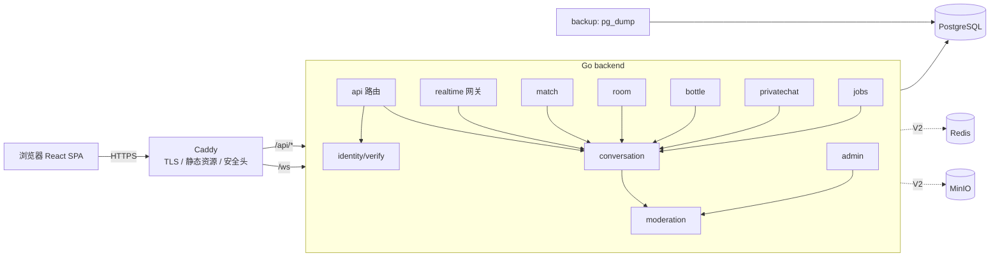

# 技术设计: AnonChat 匿名聊天平台（V1 + V2）

## 技术方案

### 核心技术

| 层 | 选型 | 说明 |
|---|---|---|
| 后端语言 | Go（本机 1.27.1，`go.mod` 写 `go 1.27`） | |
| HTTP 路由 | 标准库 `net/http`（ServeMux 方法 + 路径模式） | 不引入 Web 框架 |
| WebSocket | `github.com/coder/websocket` | 支持 context，API 简洁，维护活跃 |
| 数据库驱动 | `github.com/jackc/pgx/v5`（pgxpool） | |
| SQL 代码生成 | `sqlc`（只在开发期用的工具） | 类型安全，查询全部参数化 |
| 迁移 | `github.com/pressly/goose/v3`（迁移 SQL 用 embed 打进二进制） | `server migrate up` 子命令，启动时也会自动执行 |
| 日志 | 标准库 `log/slog`（JSON） | |
| 密码 / 加密 | `golang.org/x/crypto`（bcrypt），标准库 `crypto/aes`、`crypto/hmac` | |
| TOTP（V2） | `github.com/pquerna/otp` | |
| Redis（V2） | `github.com/redis/go-redis/v9` | |
| 对象存储（V2） | `github.com/minio/minio-go/v7` + MinIO 容器 | 与 S3 兼容，以后可以换云 OSS |
| 指标（V2） | `github.com/prometheus/client_golang` | |
| 前端 | React 19 + TypeScript + Vite | pnpm 管理依赖 |
| 前端路由 / 状态 | React Router、Zustand | |
| 样式 | Tailwind CSS v4 | |
| 前端测试 | Vitest + Testing Library；Playwright（E2E） | |
| 数据库 | PostgreSQL 17（Docker 官方镜像） | |
| 边缘代理 | Caddy 2（自动 HTTPS，提供静态资源和反向代理） | |
| 压测（V2，开发工具） | k6 | 只用于 `loadtest/`，不进入运行时 |

依赖版本在任务 1.1、1.2 实施时锁定为当时的最新稳定版，写入 `go.mod` 和 `pnpm-lock.yaml`。

### 实现要点
- **统一会话模型:** 四种形态都抽象成 `Conversation(kind)`，加上 `ConversationMember` 和 `Message`。消息收发、历史、举报、保留期、阅后即焚只实现一套，各形态模块只负责"会话怎么产生、谁能加入"。
- **实时状态先放内存（V1）:** Hub（连接表）、Presence（在线）、Matcher（匹配队列）、RateLimiter 都通过接口访问。V1 用进程内实现，V2 换成 Redis 实现，业务代码不用改。
- **对外不暴露身份 ID:** 其他用户只能看到会话内别名 `memberId`（会话内的序号）、昵称和头像种子。`identity_id` 只在服务端和管理后台出现。
- **消息可靠性:** 客户端为每条消息生成 `clientMsgId`（UUID），服务端用 `(sender_identity_id, client_msg_id)` 唯一约束做幂等，落库后先回 `ack` 再广播。重连后客户端按会话的最后一条消息 ID 调用 REST 补拉。
- **保留期:** `jobs` 每 10 分钟分批（每批 5,000 行）删除过期数据，过期时间都可配置。

## 设计边界
- **范围内:** why.md 列出的 V1 和 V2 全部能力。
- **范围外:** 见 why.md 范围外清单；端到端加密、原生 App、音视频都不做。
- **模块职责:**

| 后端模块 | 职责 |
|---|---|
| `config` | 从环境变量加载并校验配置 |
| `platform/db`、`platform/httpx` | 连接池、事务辅助、JSON 响应、错误码、中间件（RequestID、日志、Recover、安全头、Origin 校验） |
| `store` | sqlc 生成的查询代码；`migrations/` 存放 SQL |
| `identity` | 签发、校验、重置匿名身份；生成昵称和头像种子；身份中间件 |
| `verify` | 手机号验证码；`SMSProvider` 接口（`console` 实现 + 真实服务商实现）；手机号加密和 HMAC |
| `realtime` | WebSocket 握手、读写泵、心跳、协议编解码、Hub/Presence/Broker 接口和内存实现 |
| `conversation` | 会话、成员、消息的增删查；发送管道（校验 → 限流 → 敏感词 → 落库 → ack → 广播）；阅后即焚；历史分页 |
| `match` | 匹配队列、配对规则、断线宽限、跳过 |
| `room` | 官方房间（V2 增加自建房间）、加入退出、满员、在线人数 |
| `bottle` | 投放、捞取、扔回、回复、我的瓶子、每日配额 |
| `privatechat` | 私密链接的创建、加入、密码、过期、销毁 |
| `moderation` | 敏感词（AC 自动机）、限流、屏蔽、举报快照、封禁检查 |
| `admin` | 管理员账号、会话、举报处理、封禁、统计、审计日志 |
| `jobs` | 定时任务调度：保留期清理、过期链接和瓶子、房间归档（V2） |
| V2 `redisx` | Redis 版的 Broker/Presence/Matcher/RateLimiter |
| V2 `media` | 图片上传、校验、重新编码、存储、`Moderator` 接口 |
| V2 `captcha` | `Captcha` 接口和服务商实现 |
| V2 `push` | Web Push 订阅和推送（VAPID） |
| V2 `metrics` | Prometheus 指标 |

- **接口契约:** 见下文"API 设计"和"WebSocket 协议"。错误统一为 `{"error":{"code":"<snake_case>","message":"<中文提示>"}}`。
- **数据边界:** 只新建 PostgreSQL schema（见"数据模型"）。V2 新增 Redis（只放易失状态，丢失后可以重建）和对象存储（图片，7 天过期）。
- **依赖边界:** 只引入上表列出的依赖。前端不引入 UI 组件库（用 Tailwind 自己写），不引入 Redux 或 TanStack Query，REST 请求用轻量的 `fetch` 封装。
- **最小改动:** 新项目，按上述目录创建，不做额外抽象。接口只在"V1 内存、V2 Redis"或"可替换第三方服务商"这两种确实需要替换的地方定义。

### 目录结构

```
AnonChat/
├── Makefile                      # dev / test / lint / build / e2e 等常用命令
├── backend/
│   ├── go.mod
│   ├── sqlc.yaml
│   ├── cmd/server/main.go        # 子命令: serve | migrate up/down | admin create
│   ├── migrations/               # goose SQL, embed
│   ├── queries/                  # sqlc 查询 SQL
│   └── internal/
│       ├── config/  platform/{db,httpx}/  store/
│       ├── identity/  verify/  realtime/  conversation/
│       ├── match/  room/  bottle/  privatechat/
│       ├── moderation/  admin/  jobs/  api/   # api: 路由装配
│       └── (V2) redisx/  media/  captcha/  push/  metrics/
├── frontend/
│   ├── src/
│   │   ├── app/                  # 路由、布局、全局 Provider
│   │   ├── lib/{ws,api}/         # WebSocket 客户端（重连 / 发件箱 / 补拉）、REST 封装
│   │   ├── stores/               # Zustand：identity、conversations、presence
│   │   ├── components/           # 消息列表、输入框、头像、举报 / 屏蔽弹窗
│   │   └── features/{home,match,rooms,bottles,private,admin}/
│   └── e2e/                      # Playwright
└── deploy/
    ├── docker-compose.yml        # 生产：postgres backend web backup（V2: redis minio，profile: monitoring）
    ├── docker-compose.dev.yml    # 开发和测试：postgres（V2: redis minio）
    ├── backend.Dockerfile  web.Dockerfile  Caddyfile
    ├── backup/                   # pg_dump 定时脚本
    └── .env.example
```

## 架构设计



**发送消息的管道:**
`msg.send` → 校验身份和封禁 → 校验会话成员和会话状态 → 限流 → 长度和格式校验 → 敏感词（拦截或打码）→ 屏蔽关系过滤 → 写库（幂等）→ 回复 `ack` → Broker 广播给会话在线成员（排除屏蔽了发送者的成员）。

## 架构决策 ADR

### ADR-001: 四种聊天形态共用统一的会话模型
**上下文:** A、B、C、D 都需要消息收发、历史、举报、保留期和屏蔽。
**决策:** 使用 `conversations(kind)`、`conversation_members`、`messages`，各形态只在各自的表里保存形态特有的数据（rooms、bottles、private_links），通过 `conversation_id` 关联。
**理由:** 消息管道、保留期、举报证据只需要实现一次；以后增加新形态的成本低。
**替代方案:** 每种形态各有一张消息表 → 拒绝原因：同样的逻辑要写四遍，举报和清理也要分别处理。
**影响:** `messages` 是热点表，需要 `(conversation_id, id)` 和 `(created_at)` 索引；房间消息量最大，V1 先观察，如有需要再考虑分区（见 ADR-006）。
**状态:** 候选

### ADR-002: V1 实时状态用进程内实现，V2 再引入 Redis
**上下文:** V1 单实例上线；V2 需要水平扩展。
**决策:** Hub/Broker、Presence、Matcher、RateLimiter 定义成接口。V1 用内存实现，V2 增加 `redisx` 实现，通过 `REALTIME_BACKEND=memory|redis` 切换。
**理由:** V1 少一个组件，部署和测试更简单；单个 Go 实例足以支撑 5,000 个以上的连接。
**替代方案:** V1 就直接用 Redis → 拒绝原因：单实例阶段没有收益，反而增加运维负担和测试依赖。
**影响:** V1 重启会丢失匹配队列和在线状态，客户端重连后自动恢复（重新排队、重新加入房间），持久化数据不受影响。
**状态:** 候选

### ADR-003: 匿名身份用 HttpOnly Cookie 承载不透明令牌
**上下文:** 免注册身份需要防止被盗用，WebSocket 也需要鉴权。
**决策:** 服务端生成 32 字节随机令牌，放进 `__Host-anon` Cookie（`HttpOnly; Secure; SameSite=Lax; Path=/`，有效期 365 天），数据库保存 `sha256(token)`。WebSocket 握手自动携带这个 Cookie，并且严格校验 `Origin` 白名单；所有修改类 REST 请求同样校验 Origin。
**理由:** XSS 读不到令牌，令牌不会出现在 URL 和日志里，也可以立即吊销。
**替代方案:** 令牌放 localStorage 或 JWT → 拒绝原因：XSS 可以窃取；JWT 不能立即吊销，而封禁和换身份都要求立即生效。
**影响:** 前后端必须同源部署（Caddy 统一入口）；本地开发用 Vite 代理，保持同源。
**状态:** 候选

### ADR-004: 阅后即焚只对用户界面生效，不做端到端加密
**上下文:** 公开上线需要内容审核、举报取证和日志留存，这与端到端加密和"服务端立即删除"冲突。
**决策:** 阅后即焚的消息在接收方阅读 10 秒后，从双方界面和历史接口中隐藏（`burned_at`）；服务端保留到 7 天期满后物理删除。界面和隐私政策中如实说明。
**理由:** 兼顾"不留痕"的体验和合规、治理需要。
**替代方案:** 端到端加密加服务端零存储 → 拒绝原因：无法审核，举报也拿不到证据，不符合公开上线的合规要求。
**影响:** 不能宣传为"服务端不留存"。
**状态:** 已采纳（2026-11-06 用户确认）

### ADR-005: 前台匿名、后台可追溯，实名验证可配置
**上下文:** 国内公开上线通常要求"后台实名、前台自愿"；海外或内测阶段可以不需要。
**决策:** `VERIFICATION_MODE=off|optional|required`，默认 `off`（开发环境）；手机号验证码通过 `SMSProvider` 接口接入。手机号用 AES-256-GCM 加密存储，HMAC-SHA256 用于去重和查找；其他用户永远看不到实名信息。
**理由:** 一套代码可以适配不同的上线地区和阶段。
**替代方案:** 强制所有用户实名 → 拒绝原因：首次使用门槛高，海外或内测阶段不需要；完全不支持实名 → 拒绝原因：无法满足国内合规。
**影响:** 生产环境开启 `required` 前，必须配置好短信服务商和密钥（HITL）。
**状态:** 已采纳（2026-11-06 用户确认）

### ADR-006: 过期数据用定时分批 DELETE 清除，暂不做分区表
**上下文:** 消息保存 7 天后清除。
**决策:** `jobs` 每 10 分钟执行 `DELETE ... WHERE id IN (SELECT id ... WHERE created_at < now()-retention LIMIT 5000)`，循环直到删完。
**理由:** 实现简单，配合 `created_at` 索引，在百万级日消息量下足够。
**替代方案:** 按天分区，直接 DROP 过期分区 → 拒绝原因：分区维护的复杂度在当前规模下没有必要；如果日消息量超过约 500 万，再按这个替代方案迁移。
**影响:** 需要关注 autovacuum；指标中记录每次清理的行数和耗时（V2）。
**状态:** 候选

### ADR-007: 用 Caddy 作为边缘代理
**上下文:** 公开上线需要 HTTPS、静态资源服务、反向代理和 WebSocket。
**决策:** `web` 镜像分两阶段构建：先构建前端，再用 Caddy 运行时提供静态文件，`/api/*` 和 `/ws` 反向代理到 backend，同时负责自动申请证书和安全响应头。
**替代方案:** Nginx 加 certbot → 拒绝原因：证书续期需要额外处理，配置也更繁琐。
**影响:** 如果服务器前面已经有云负载均衡或 CDN，可以把 Caddy 的 TLS 关掉，只保留代理功能（通过 `.env` 切换）。
**状态:** 候选

## API 设计

所有 `/api/*` 请求都需要身份 Cookie（`POST /api/identity` 除外）；返回 JSON；分页使用基于 ID 的游标。

### 身份
- `POST /api/identity`：没有有效 Cookie 时创建身份，有则直接返回现有身份。响应 `{nickname, avatarSeed, verified}`（不返回身份 ID），同时设置 Cookie。
- `GET /api/identity/me`：`{nickname, avatarSeed, verified, verificationMode}`
- `POST /api/identity/reset`：换身份，返回新的身份信息，同时设置新 Cookie。
- `POST /api/verify/sms/send`：`{phone}` → `204`（V2 起需要附带 `captchaToken`）
- `POST /api/verify/sms/confirm`：`{phone, code}` → `{verified:true}`

### 会话与消息
- `GET /api/conversations?kind=`：我参与的进行中会话（match、bottle、private），包含未读数。
- `GET /api/conversations/{id}` → `{id, kind, burnAfterRead, endedAt, endReason, myMemberId, peer?:{memberId,nickname,avatarSeed}}`（实施中补充：前端需要可靠地知道自己在会话中的 memberId；peer 仅 1v1 会话返回）
- `GET /api/conversations/{id}/messages?before=&after=&limit=50`：只有成员可以访问；不返回已焚毁的消息和被屏蔽者的消息。
- `POST /api/conversations/{id}/block`：屏蔽该会话中的对方（1v1 会话）。
- `POST /api/conversations/{id}/members/{memberId}/block`：屏蔽房间里的某个成员。
- `POST /api/reports`：`{conversationId, memberId, messageIds[], reason, note?}` → `{id}`

### 聊天室
- `GET /api/rooms`：`[{id, slug, name, description, online, maxMembers}]`
- `GET /api/rooms/{id}/messages?before=&limit=50`
- V2 `POST /api/rooms`：`{name, description, visibility:"public"|"private", password?}` → `{id, inviteToken?}`
- V2 `POST /api/rooms/join-by-invite`：`{inviteToken, password?}` → `{roomId}`
- V2 `POST /api/rooms/{id}/kick`、`POST /api/rooms/{id}/mute`：`{memberId, minutes?}`（仅房主）

### 漂流瓶
- `POST /api/bottles`：`{content}` → `{id}`
- `POST /api/bottles/pick` → `{id, content, createdAt}` 或 `404 empty_sea`
- `POST /api/bottles/{id}/throw-back` → `204`
- `POST /api/bottles/{id}/reply`：`{content}` → `{conversationId}`
- `GET /api/bottles/mine` → `[{id, contentPreview, createdAt, replies:[{conversationId, unread}]}]`
- `POST /api/bottles/{id}/report`：`{reason, note?}` → `{id}`（仅当前持有者可举报；快照保存瓶子内容。实施中补充：漂流瓶在回复前没有会话，无法走会话举报）

### 私密链接
- `POST /api/private-links`：`{password?, ttlHours(1-168, 默认 24), burnAfterRead}` → `{token, conversationId, expiresAt}`（前端拼成 `/p/{token}`）
- `GET /api/private-links/{token}` → `{needPassword, burnAfterRead, status}`
- `POST /api/private-links/{token}/join`：`{password?}` → `{conversationId}`
- `POST /api/private-links/{token}/destroy` → `204`（仅成员可调用）

### 管理后台（使用独立的 `__Host-admin` Cookie，有效期 8 小时）
- `POST /api/admin/login`：`{username, password, totp?(V2)}`；`POST /api/admin/logout`
- `GET /api/admin/reports?status=open|resolved&cursor=`；`GET /api/admin/reports/{id}`（包含证据快照、被举报者的身份摘要和脱敏手机号）
- `POST /api/admin/reports/{id}/resolve`：`{action:"dismiss"|"ban", ban?:{subjects:["identity","ip","account"], durationHours|null, reason}}`
- `GET /api/admin/bans`、`POST /api/admin/bans`、`DELETE /api/admin/bans/{id}`
- `GET /api/admin/stats` → `{online, activeConversations, messages24h, openReports}`
- `GET /api/admin/audit-logs?cursor=`
- V2 `GET/POST/DELETE /api/admin/sensitive-words`、`POST /api/admin/rooms/{id}/archive`、`POST /api/admin/totp/enroll|confirm`

### 运维
- `GET /healthz`（存活检查）、`GET /readyz`（检查数据库连接）
- V2 `GET /metrics`（只在内部网络开放，Caddy 不对外暴露）

## WebSocket 协议

连接地址 `GET /ws`（凭 Cookie 鉴权，校验 Origin）。帧格式为 JSON 文本，单帧不超过 16KB。

```jsonc
// 客户端 → 服务端
{"t": "msg.send", "id": "<客户端请求ID>", "d": { /* payload */ }}
// 服务端 → 客户端
{"t": "msg.new", "d": { /* payload */ }, "ts": 1762400000000}
{"t": "ack", "id": "<客户端请求ID>", "d": {"messageId": 123, "createdAt": "..."}}
{"t": "error", "id": "<客户端请求ID，可选>", "d": {"code": "rate_limited", "message": "..."}}
```

| 方向 | 类型 | payload |
|---|---|---|
| C→S | `ping` | — （客户端每 25 秒发送一次；服务端 60 秒收不到任何帧就断开连接） |
| C→S | `match.start` / `match.cancel` / `match.next` / `match.leave` | V2 中 `match.start` 可以带 `{tags[], lang}` |
| C→S | `room.join` / `room.leave` | `{roomId}` |
| C→S | `conv.subscribe` | `{conversationIds[]}`（用于漂流瓶和私密会话的实时推送） |
| C→S | `msg.send` | `{conversationId, clientMsgId, kind:"text"\|"image"(V2), body, mediaId?(V2)}` |
| C→S | `msg.read` | `{conversationId, messageId}` |
| C→S | `typing` | `{conversationId}`（客户端节流，每 3 秒最多发一次） |
| S→C | `hello` | `{nickname, avatarSeed, resumable: [conversationId]}` |
| S→C | `pong` / `ack` / `error` | |
| S→C | `match.waiting` / `match.found` | `{conversationId, peer:{memberId,nickname,avatarSeed}}` |
| S→C | `match.ended` / `conv.ended` | `{conversationId, reason:"peer_left"\|"peer_skipped"\|"destroyed"\|"expired"\|"blocked"}` |
| S→C | `room.presence` | `{roomId, online}`（每秒最多推送一次） |
| S→C | `msg.new` | `{conversationId, message:{id, memberId, nickname, avatarSeed, kind, body, createdAt, burnAfterRead}}` |
| S→C | `msg.burned` | `{conversationId, messageIds[]}` |
| S→C | `typing` | `{conversationId, memberId}` |
| S→C | `bottle.reply` | `{bottleId, conversationId}` |
| S→C | `kicked` | `{reason:"banned"\|"identity_reset"}`，发送后服务端关闭连接 |

**错误码:** `unauthorized`、`verification_required`、`banned`、`rate_limited`、`content_blocked`、`not_member`、`conversation_ended`、`room_full`、`link_full`、`link_expired`、`bad_password`、`empty_sea`、`quota_exceeded`、`invalid_request`、`internal`；V2 新增 `muted`、`captcha_required`、`media_rejected`。

## 数据模型

```sql
CREATE TYPE conversation_kind AS ENUM ('match','room','bottle','private');

CREATE TABLE verified_accounts (
  id            uuid PRIMARY KEY DEFAULT gen_random_uuid(),
  phone_hmac    bytea NOT NULL UNIQUE,
  phone_enc     bytea NOT NULL,          -- AES-256-GCM(nonce||ciphertext)
  phone_masked  text  NOT NULL,          -- 138****1234
  created_at    timestamptz NOT NULL DEFAULT now()
);

CREATE TABLE identities (
  id            uuid PRIMARY KEY DEFAULT gen_random_uuid(),
  token_hash    bytea NOT NULL UNIQUE,
  nickname      text  NOT NULL,
  avatar_seed   text  NOT NULL,
  account_id    uuid REFERENCES verified_accounts(id),
  created_ip    inet,
  revoked_at    timestamptz,             -- 换身份后置为非空
  created_at    timestamptz NOT NULL DEFAULT now(),
  last_seen_at  timestamptz NOT NULL DEFAULT now()
);

CREATE TABLE sms_codes (
  id           bigserial PRIMARY KEY,
  phone_hmac   bytea NOT NULL,
  code_hash    bytea NOT NULL,
  attempts     int NOT NULL DEFAULT 0,
  expires_at   timestamptz NOT NULL,
  consumed_at  timestamptz,
  created_at   timestamptz NOT NULL DEFAULT now()
);

CREATE TABLE conversations (
  id          uuid PRIMARY KEY DEFAULT gen_random_uuid(),
  kind        conversation_kind NOT NULL,
  burn_after_read boolean NOT NULL DEFAULT false,
  ended_at    timestamptz,
  end_reason  text,
  created_at  timestamptz NOT NULL DEFAULT now()
);

CREATE TABLE conversation_members (
  conversation_id uuid NOT NULL REFERENCES conversations(id) ON DELETE CASCADE,
  member_id       int  NOT NULL,          -- 会话内的别名序号，对外只暴露这个值
  identity_id     uuid NOT NULL REFERENCES identities(id),
  role            text NOT NULL DEFAULT 'member',   -- member | owner(V2 房间)
  last_read_message_id bigint,
  muted_until     timestamptz,            -- V2 房间禁言
  joined_at       timestamptz NOT NULL DEFAULT now(),
  left_at         timestamptz,
  PRIMARY KEY (conversation_id, member_id),
  UNIQUE (conversation_id, identity_id)
);
CREATE INDEX ON conversation_members (identity_id) WHERE left_at IS NULL;

CREATE TABLE messages (
  id               bigserial PRIMARY KEY,
  conversation_id  uuid NOT NULL REFERENCES conversations(id) ON DELETE CASCADE,
  sender_identity_id uuid NOT NULL REFERENCES identities(id),
  sender_member_id int NOT NULL,
  client_msg_id    uuid NOT NULL,
  kind             text NOT NULL DEFAULT 'text',     -- text | system | image(V2)
  body             text NOT NULL,
  media_id         uuid,                             -- V2
  read_at          timestamptz,
  burned_at        timestamptz,
  created_at       timestamptz NOT NULL DEFAULT now(),
  UNIQUE (sender_identity_id, client_msg_id)
);
CREATE INDEX ON messages (conversation_id, id);
CREATE INDEX ON messages (created_at);

CREATE TABLE rooms (
  id              uuid PRIMARY KEY DEFAULT gen_random_uuid(),
  conversation_id uuid NOT NULL UNIQUE REFERENCES conversations(id),
  slug            text NOT NULL UNIQUE,
  name            text NOT NULL,
  description     text NOT NULL DEFAULT '',
  kind            text NOT NULL DEFAULT 'official',  -- official | user(V2)
  visibility      text NOT NULL DEFAULT 'public',    -- public | private(V2)
  owner_identity_id uuid REFERENCES identities(id),  -- V2
  password_hash   text,                               -- V2
  invite_token_hash bytea UNIQUE,                     -- V2
  max_members     int  NOT NULL DEFAULT 500,
  sort_order      int  NOT NULL DEFAULT 0,
  last_message_at timestamptz,
  archived_at     timestamptz,
  created_at      timestamptz NOT NULL DEFAULT now()
);

CREATE TABLE bottles (
  id            uuid PRIMARY KEY DEFAULT gen_random_uuid(),
  identity_id   uuid NOT NULL REFERENCES identities(id),
  content       text NOT NULL,
  status        text NOT NULL DEFAULT 'floating',  -- floating | held | removed
  held_by       uuid REFERENCES identities(id),
  held_until    timestamptz,                       -- 捞起后 10 分钟内不处理就自动回到池中
  expires_at    timestamptz NOT NULL,
  created_at    timestamptz NOT NULL DEFAULT now()
);
CREATE INDEX ON bottles (status, expires_at);

CREATE TABLE bottle_picks (
  bottle_id        uuid NOT NULL REFERENCES bottles(id) ON DELETE CASCADE,
  picker_identity_id uuid NOT NULL REFERENCES identities(id),
  conversation_id  uuid REFERENCES conversations(id),   -- 回复后才有
  picked_at        timestamptz NOT NULL DEFAULT now(),
  PRIMARY KEY (bottle_id, picker_identity_id)
);

CREATE TABLE private_links (
  id              uuid PRIMARY KEY DEFAULT gen_random_uuid(),
  token_hash      bytea NOT NULL UNIQUE,
  conversation_id uuid NOT NULL UNIQUE REFERENCES conversations(id),
  creator_identity_id uuid NOT NULL REFERENCES identities(id),
  password_hash   text,
  expires_at      timestamptz NOT NULL,
  destroyed_at    timestamptz,
  created_at      timestamptz NOT NULL DEFAULT now()
);

CREATE TABLE blocks (
  blocker_identity_id uuid NOT NULL REFERENCES identities(id),
  blocked_identity_id uuid NOT NULL REFERENCES identities(id),
  created_at          timestamptz NOT NULL DEFAULT now(),
  PRIMARY KEY (blocker_identity_id, blocked_identity_id)
);

CREATE TABLE reports (
  id                  uuid PRIMARY KEY DEFAULT gen_random_uuid(),
  reporter_identity_id uuid NOT NULL REFERENCES identities(id),
  reported_identity_id uuid NOT NULL REFERENCES identities(id),
  conversation_id     uuid,              -- 不加外键：会话清理后举报仍然保留
  reason              text NOT NULL,     -- spam | harassment | porn | illegal | other
  note                text,
  snapshot            jsonb NOT NULL,    -- 被举报消息及前后各 10 条上下文
  status              text NOT NULL DEFAULT 'open',
  handled_by          uuid,
  handled_at          timestamptz,
  created_at          timestamptz NOT NULL DEFAULT now()
);

CREATE TABLE bans (
  id            uuid PRIMARY KEY DEFAULT gen_random_uuid(),
  subject_type  text NOT NULL,           -- identity | ip | account
  subject_value text NOT NULL,
  reason        text NOT NULL,
  expires_at    timestamptz,             -- NULL 表示永久
  created_by    uuid,
  revoked_at    timestamptz,
  created_at    timestamptz NOT NULL DEFAULT now()
);
CREATE INDEX ON bans (subject_type, subject_value) WHERE revoked_at IS NULL;

CREATE TABLE access_logs (            -- 合规留存，默认 180 天
  id          bigserial PRIMARY KEY,
  identity_id uuid,
  event       text NOT NULL,           -- identity_created | ws_connect | ws_disconnect | verify | report ...
  ip          inet,
  user_agent  text,
  created_at  timestamptz NOT NULL DEFAULT now()
);
CREATE INDEX ON access_logs (created_at);

CREATE TABLE admin_users (
  id            uuid PRIMARY KEY DEFAULT gen_random_uuid(),
  username      text NOT NULL UNIQUE,
  password_hash text NOT NULL,          -- bcrypt cost 12
  totp_secret_enc bytea,                -- V2
  created_at    timestamptz NOT NULL DEFAULT now()
);
CREATE TABLE admin_sessions (
  token_hash bytea PRIMARY KEY,
  admin_id   uuid NOT NULL REFERENCES admin_users(id) ON DELETE CASCADE,
  expires_at timestamptz NOT NULL,
  created_at timestamptz NOT NULL DEFAULT now()
);
CREATE TABLE admin_audit_logs (
  id        bigserial PRIMARY KEY,
  admin_id  uuid NOT NULL,
  action    text NOT NULL,
  target    text,
  detail    jsonb,
  created_at timestamptz NOT NULL DEFAULT now()
);

-- V2 迁移新增
-- media(id, owner_identity_id, object_key, mime, width, height, size, moderation_status, created_at)
-- match_profiles 不落库（标签和语言只在匹配队列里存在）
-- sensitive_words(id, word, level: block|mask, created_at)
-- push_subscriptions(id, identity_id, endpoint, p256dh, auth, created_at)
```

**保留期（`jobs`，都可以配置）:**

| 数据 | 默认保留 | 配置项 |
|---|---|---|
| messages（包括已焚毁的） | 7 天 | `MESSAGE_RETENTION=168h` |
| 已结束、且消息已清空的 conversations | 结束后 7 天 | 同上 |
| bottles / bottle_picks | 7 天 | `BOTTLE_TTL=168h` |
| private_links | 过期或销毁后 7 天 | 同上 |
| V2 media 对象 | 7 天 | 同上 |
| sms_codes | 1 天 | 固定 |
| access_logs | 180 天 | `AUDIT_RETENTION=4320h` |
| reports.snapshot | 180 天 | 同上 |
| 已撤销的 identities（且没有关联的举报或封禁） | 180 天 | 同上 |

## 安全与性能

- **安全:**
  - 身份和管理员 Cookie 都使用 `__Host-` 前缀，带 `HttpOnly; Secure; SameSite`；WebSocket 握手和修改类 REST 请求都校验 Origin 白名单（`ALLOWED_ORIGINS`）。
  - 所有令牌（身份、私密链接、邀请、管理员会话）都是 ≥128 位的随机值，数据库只存 SHA-256 哈希，比较时使用常量时间比较。
  - SQL 全部由 sqlc 生成，参数化执行；JSON 解码使用 `DisallowUnknownFields`，并限制请求体大小（REST 64KB，WS 帧 16KB）。
  - 前端只用文本方式渲染消息（不使用 `dangerouslySetInnerHTML`）；URL 不自动变成可点击链接（V1）。Caddy 配置 CSP `default-src 'self'`、HSTS、`X-Content-Type-Options`、`Referrer-Policy: no-referrer`、`Permissions-Policy`。
  - 手机号加密存储（`PHONE_ENC_KEY`）并做 HMAC（`PHONE_HMAC_KEY`）；密钥只从环境变量读取，`.env` 不入库，只提交 `.env.example`；slog 对 phone、token、password 字段做脱敏。
  - 管理后台：bcrypt 哈希密码，登录失败按账号和 IP 限流，所有操作写审计日志；可以通过 `ADMIN_IP_ALLOWLIST` 限制访问 IP（V2 增加 TOTP）。
  - IP 获取：只信任 Caddy 设置的 `X-Forwarded-For`（`TRUSTED_PROXIES` 配置）。
- **频率限制默认值（全部可配置）:**

| 对象 | 限制 |
|---|---|
| 每个 IP 创建身份 | 10 次/小时 |
| 每个身份发消息 | 令牌桶 5/秒，突发 10；房间里每条消息间隔 ≥ 1 秒 |
| 开始匹配 | 30 次/分钟 |
| 投放漂流瓶 / 捞漂流瓶 | 10 次/天、50 次/天 |
| 创建私密链接 | 20 次/天 |
| 私密链接密码错误 | 每个链接、身份或 IP 5 次/10 分钟 |
| 短信验证码 | 每个手机号 1 次/60 秒、5 次/天；每个 IP 20 次/天 |
| 管理员登录失败 | 5 次/15 分钟 |

- **性能:**
  - 每个连接一个读 goroutine 和一个写 goroutine；写缓冲通道容量 64，写满时判定为慢客户端并断开连接。
  - 房间广播在内存里扇出，在线人数推送合并到每秒一次。
  - 消息历史使用 `(conversation_id, id)` 游标分页；pgxpool 最大连接数默认 20。
  - 匹配器单 goroutine 加通道，避免锁竞争；配对复杂度为 O(队列长度)，V1 规模下足够。

## 测试与部署

- **测试分层:**
  - 单元测试：纯逻辑部分（昵称生成、敏感词、限流、匹配规则、协议编解码、加密工具），使用 `go test ./...`。
  - 集成测试：连接真实 PostgreSQL（`deploy/docker-compose.dev.yml` 启动，环境变量 `TEST_DATABASE_URL`），用 build tag `integration` 区分，命令 `make test-integration`。每个测试使用独立的 schema 或事务回滚。
  - WebSocket 集成测试：`httptest.Server` 加 `coder/websocket` 客户端，模拟多客户端的匹配、聊天、房间和封禁踢出。
  - 前端：Vitest 测试 WS 客户端（重连、发件箱、补拉）和 store。
  - E2E：Playwright 打开多个浏览器上下文，跑 A、B、C、D 和管理员封禁五条核心流程，分别针对开发环境和 compose 环境。
  - V2：使用两个后端实例加 Redis，测试跨节点匹配、广播和限流。
- **静态检查:** `go vet`、`staticcheck`、`govulncheck`；`pnpm lint`（ESLint）、`pnpm typecheck`、`pnpm audit --prod`。
- **部署:**
  1. 服务器安装 Docker，复制 `deploy/` 和 `.env`（按 `.env.example` 填写域名、数据库密码和各类密钥）。
  2. 执行 `docker compose up -d`；backend 启动时自动执行 `migrate up`；执行 `docker compose exec backend server admin create --username <name>` 创建管理员（交互式输入密码）。
  3. 备份：`backup` 容器每天 03:00 执行 `pg_dump -Fc`，保留 7 份，存放在 `backups` 卷中（建议另外同步到异地存储，由运维配置）。
  4. 回滚：镜像使用版本 tag；迁移必须提供 down 脚本，回滚顺序为先 `migrate down` 再回退镜像。

## 领域语言（待写入 wiki/glossary.md）

| 推荐名称 | 代码命名 | 含义 | 禁用叫法 |
|---|---|---|---|
| 匿名身份 | `Identity` | 由 Cookie 令牌标识的免注册用户 | 用户、账号（账号专指 `VerifiedAccount`） |
| 实名账号 | `VerifiedAccount` | 已验证手机号的后台实名记录 | — |
| 会话 | `Conversation` | 所有聊天形态共用的消息容器，`kind` 取值为 match、room、bottle、private | 聊天、频道 |
| 成员别名 | `memberId` | 某人在一个会话内的匿名序号，对外只暴露这个值 | userId |
| 随机匹配 | `match` | A 形态 | — |
| 聊天室 | `Room` | B 形态，每个房间对应一个长期会话 | 群、频道 |
| 漂流瓶 | `Bottle` | C 形态，投放、捞取、回复 | 树洞帖 |
| 私密链接 | `PrivateLink` | D 形态的邀请链接，链接对应的会话最多两人 | 房间链接 |
| 阅后即焚 | `burnAfterRead` / `burned_at` | 已读后对用户隐藏，服务端在保留期内仍然保存 | 自毁、删除 |
| 屏蔽 | `Block` | 用户之间互相不可见、不再匹配 | 拉黑（只作为界面文案） |
| 封禁 | `Ban` | 管理员对身份、IP 或实名账号的处罚 | — |
