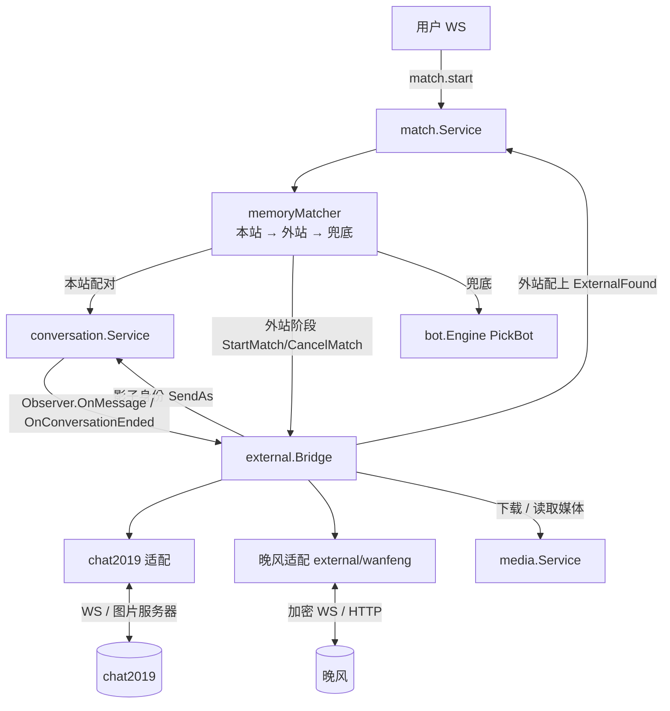

# 技术设计: 外站匹配接入（chat2019 / 晚风）与用户媒体消息

> 读法：§0 是硬性约束；§1–§8 按模块写接口约定；ADR 记录取舍。`how.md` 没写到的细节，沿用现有代码的写法。
> 参考源码：liao 项目 `/Users/zcw/project/liao`（只读，HEAD `5fe3a8e`）。下文写 `liao:` 的路径都指这个项目。

## 0. 硬性约束

1. **外站总开关默认关闭**。关闭时，匹配、bot 兜底、消息管线的行为必须与现在完全一致（现有测试全部不改就能通过）。
2. **匹配 goroutine 内禁止访问数据库和网络**（沿用 `matcher.go` 的约定）。外站调用、建会话、查库都在匹配 goroutine 之外进行，通过命令通道和匹配器交互。
3. **所有计时由匹配器负责**（本站等待、外站匹配时长、兜底时机）。Bridge 只执行「开始匹配 / 取消匹配」，不自己计时（ADR-4）。
4. **外站消息一律经 `conversation.Service.SendAs` 落库和广播**，不允许绕过管线直接写 `messages` 表。
5. **隐私**：发给外站的只有性别、已设置的年龄，以及绑定时随机生成的昵称。不传 IP、省份和本站昵称（chat2019 的 `userip` / `useraddree` 填空字符串，晚风 `showCity=false`）。
6. **晚风包原样移植**：`internal/external/wanfeng/` 相对 liao 只允许做本方案列出的改动（见 §4.1），每一处都记录到 `PORTED_FROM.md`。
7. 不 git commit；不连接远程或生产环境；单元测试和集成测试不访问真实外站（用 `httptest` 伪造上游）。访问真实外站只在 HITL 任务里由人工执行。
8. **每一次外站匹配都有不可复用的代次（attempt）**。Start / Cancel / Found / Failed 全链路都带代次，过期代次的任何结果一律作废（§3）。
9. **本站文件只能因为「数据库里一条已授权的媒体消息」被上传到外站**。文本内容永远不会被解析成媒体；内部媒体 token 只认 Bridge 自己登记过的（§5.2、§6.5）。
10. **外站网络访问必须经过地址守卫**（§4.3）：直连时禁止连接回环、内网、链路本地等地址，重定向同样检查；克隆出来的客户端同样受约束。例外：晚风配置了出口代理时，改为只允许运维配置的公网域名白名单（代理侧的 DNS 解析不受本机控制，剩余风险见 §4.3）。

## 技术方案

### 核心技术
- Go（沿用 `pgx` / `sqlc` / `goose`）。新增依赖 `github.com/gorilla/websocket v1.5.3`、`github.com/google/uuid v1.6.0`，只给晚风包用（ADR-2）。chat2019 客户端使用项目现有的 `github.com/coder/websocket`。
- 前端沿用 React + TypeScript + Vitest。

### 实现要点
- 匹配器增加「本站 → 外站 → 兜底」三个阶段，每次外站匹配带唯一代次（§3，ADR-4）。
- 新包 `internal/external`：设置、地址守卫、外站账号绑定、影子身份、Bridge、两个站点的适配（§4、§5）。
- 外站发来的帧统一按 **chat2019 帧格式**解析（晚风包本来就翻译成这个格式）；发往外站的动作由各站点适配层用 `session` 方法构造（ADR-3）。
- 用户媒体复用 `media_items` 表，加 `source` / `owner_identity_id` 两列（§6，ADR-5）。

## 设计边界

- **范围内:** why.md「范围内」的 1–8 项。
- **范围外:** why.md「范围外」列出的全部内容。
- **模块职责:**
  - `match`：排队、阶段推进、计时、认领；对外暴露 `ExternalFound`，供 Bridge 在外站配上后调用。
  - `external`：外站设置、外站账号绑定、影子身份、连接管理（容量、冷却、空闲关闭）、帧翻译、消息和媒体中转。实现 `match.ExternalMatcher` 和 `conversation.Observer`。
  - `external/wanfeng`：晚风协议包（移植）。
  - `external/chat2019`：chat2019 WS 客户端、图片服务器地址获取、媒体上传下载。
  - `media`：保存用户上传和外站下载的媒体；访问控制；用户上传接口。
  - `conversation`：`msg.send` 支持 1v1 会话中的媒体消息。
  - `jobs`：清理孤儿媒体。
- **接口契约:** 见 §3.2、§5.1、§6.3、§7.1。现有 WS 消息类型和 REST 接口只做向后兼容的扩展（新增可选字段）。
- **数据边界:** 迁移 `00010_external_bridge.sql`（§1）。只新增表和列；`media_items.folder_id` 从 NOT NULL 改为可空，并加检查约束。
- **依赖边界:** 只新增 gorilla/websocket 和 google/uuid；不升级其他依赖。
- **大型项目最小改动:** 不重构现有匹配器的配对算法和 bot 引擎；`media.Service.SaveItem` 只把「写文件 + 嗅探类型」抽成内部函数供三种来源共用，这是唯一的重构。回滚方式：后台关闭外站总开关即可停用外站；数据层用 `goose down` 回到 00009。

## 架构设计



---

## 1. 数据模型（迁移 `00010_external_bridge.sql`）

```sql
-- +goose Up

-- 外站接入全局设置（单行表，id 固定为 1；首次启动按默认值插入）。
CREATE TABLE external_settings (
  id                      smallint PRIMARY KEY DEFAULT 1 CHECK (id = 1),
  enabled                 boolean NOT NULL DEFAULT false,           -- 总开关
  chat2019_enabled        boolean NOT NULL DEFAULT false,
  wanfeng_enabled         boolean NOT NULL DEFAULT false,
  online_threshold        int NOT NULL DEFAULT 5  CHECK (online_threshold BETWEEN 0 AND 100000),
  local_wait_seconds      int NOT NULL DEFAULT 10 CHECK (local_wait_seconds BETWEEN 0 AND 600),
  external_match_seconds  int NOT NULL DEFAULT 10 CHECK (external_match_seconds BETWEEN 3 AND 120),
  chat2019_max_sessions   int NOT NULL DEFAULT 20 CHECK (chat2019_max_sessions BETWEEN 1 AND 1000),
  wanfeng_max_sessions    int NOT NULL DEFAULT 20 CHECK (wanfeng_max_sessions BETWEEN 1 AND 1000),
  updated_by              uuid REFERENCES admin_users(id) ON DELETE SET NULL,
  updated_at              timestamptz NOT NULL DEFAULT now()
);

-- 本站身份在外站的账号（每个身份每个站点一个，落库复用，避免反复注册触发风控）。
CREATE TABLE external_bindings (
  identity_id         uuid NOT NULL REFERENCES identities(id) ON DELETE CASCADE,
  provider            text NOT NULL CHECK (provider IN ('chat2019','wanfeng')),
  remote_uid          text NOT NULL,
  identity_token_enc  bytea,                     -- 晚风 identityToken，secretbox(SETTINGS_ENC_KEY)；chat2019 为 NULL
  device_id           text NOT NULL DEFAULT '',  -- 晚风每身份独立的 deviceId
  nickname            text NOT NULL DEFAULT '',  -- 绑定时随机生成，不使用本站昵称
  created_at          timestamptz NOT NULL DEFAULT now(),
  updated_at          timestamptz NOT NULL DEFAULT now(),
  PRIMARY KEY (identity_id, provider)
);

-- 外站对方 → 本站影子身份（同一外站用户复用同一影子身份，拉黑才能生效）。
CREATE TABLE external_peers (
  provider      text NOT NULL CHECK (provider IN ('chat2019','wanfeng')),
  remote_uid    text NOT NULL,
  identity_id   uuid NOT NULL UNIQUE REFERENCES identities(id),
  nickname      text NOT NULL DEFAULT '',
  first_seen_at timestamptz NOT NULL DEFAULT now(),
  last_seen_at  timestamptz NOT NULL DEFAULT now(),
  PRIMARY KEY (provider, remote_uid)
);

-- 外站会话：本站会话 ↔ 外站对方（排查和统计用；运行时映射在内存里）。
CREATE TABLE external_conversations (
  conversation_id   uuid PRIMARY KEY REFERENCES conversations(id) ON DELETE CASCADE,
  provider          text NOT NULL CHECK (provider IN ('chat2019','wanfeng')),
  user_identity_id  uuid NOT NULL REFERENCES identities(id),
  peer_identity_id  uuid NOT NULL REFERENCES identities(id),
  remote_peer_uid   text NOT NULL,
  created_at        timestamptz NOT NULL DEFAULT now()
);
CREATE INDEX external_conversations_user_idx ON external_conversations (user_identity_id, created_at DESC);

-- 媒体来源：library（后台媒体库，必须有 folder）/ user（用户上传）/ external（外站下载）。
ALTER TABLE media_items ALTER COLUMN folder_id DROP NOT NULL;
ALTER TABLE media_items
  ADD COLUMN source text NOT NULL DEFAULT 'library' CHECK (source IN ('library','user','external')),
  ADD COLUMN owner_identity_id uuid REFERENCES identities(id) ON DELETE SET NULL;
ALTER TABLE media_items
  ADD CONSTRAINT media_items_folder_source_chk CHECK ((source = 'library') = (folder_id IS NOT NULL));
CREATE INDEX media_items_nonlibrary_created_idx ON media_items (created_at) WHERE source <> 'library';

-- +goose Down
DROP INDEX IF EXISTS media_items_nonlibrary_created_idx;
-- 非媒体库的媒体行在回滚时删除（磁盘文件需人工清理 MEDIA_ROOT/user、MEDIA_ROOT/external，deploy 文档注明）。
DELETE FROM media_items WHERE source <> 'library';
ALTER TABLE media_items DROP CONSTRAINT IF EXISTS media_items_folder_source_chk;
ALTER TABLE media_items DROP COLUMN IF EXISTS owner_identity_id;
ALTER TABLE media_items DROP COLUMN IF EXISTS source;
ALTER TABLE media_items ALTER COLUMN folder_id SET NOT NULL;
DROP TABLE IF EXISTS external_conversations;
DROP TABLE IF EXISTS external_peers;
DROP TABLE IF EXISTS external_bindings;
DROP TABLE IF EXISTS external_settings;
```

查询放在新文件 `queries/external.sql`，媒体相关的查询改在 `queries/media.sql`（§6.2）。`testutil.Truncate` 加入四张新表。

影子身份用现有的 `CreateIdentity` 创建（`token_hash` 取 32 字节随机数的 SHA-256，这个 token 永远不会发给任何人，和 bot 身份的创建方式一样，参照 `internal/bot/service.go` 中调用 `CreateIdentity` 的那段），再写入 `gender` / `age` / `province` / `province_public`（见 §5.4 的映射规则），使会话详情接口里的 peer 资料与 `match.found` 一致。

---

## 2. 配置

### 2.1 环境变量（`internal/config/config.go`）

| 变量 | 默认值 | 说明 |
|---|---|---|
| `EXTERNAL_TIMEOUT_SECONDS` | `30` | 外站 HTTP 调用超时 |
| `EXTERNAL_WANFENG_HTTP_PROXY` | 空 | 可选的晚风出口代理（`http://` / `https://` / `socks5://`），对晚风的 HTTP 和 WS 生效；chat2019 始终直连（§4.3） |
| `EXTERNAL_CHAT2019_RAND_SERVER_URL` | `http://v1.chat2019.cn/Act/WebService.asmx/getRandServer?ServerInfo=serversdeskry&_=` | 获取 WS 地址（末尾拼毫秒时间戳） |
| `EXTERNAL_CHAT2019_FALLBACK_WS` | 空 | 获取失败时的备用 WS 地址；为空则视为连接失败 |
| `EXTERNAL_CHAT2019_IMG_SERVER_URL` | `http://v1.chat2019.cn/asmx/method.asmx/getImgServer` | 获取图片服务器地址 |
| `EXTERNAL_WANFENG_BASE_URL` | `https://wanfengniming.store` | 晚风站点根地址 |
| `EXTERNAL_WANFENG_WS_URL` | 空 | 留空按 BaseURL 推导 |
| `EXTERNAL_WANFENG_PROTOCOL_OVERRIDES` | 空 | 晚风 `Protocol` 覆盖 JSON（沿用 liao 的语义，解析方式参照 `liao:internal/config/config.go` 中 `WANFENG_PROTOCOL_OVERRIDES` 的处理） |
| `EXTERNAL_WANFENG_NEW_IDENTITY_PER_HOUR` | `10` | 晚风新账号注册的全局限速（每小时，令牌桶） |
| `EXTERNAL_WANFENG_MEDIA_HOSTS` | 空（= `EXTERNAL_WANFENG_BASE_URL` 的主机名） | 允许下载晚风媒体的主机名白名单（逗号分隔） |
| `USER_MEDIA_MAX_UPLOAD_MB` | `20` | 用户上传单个文件的大小上限 |

`SETTINGS_ENC_KEY` 未配置时，晚风站点视为不可用（状态原因「未配置 SETTINGS_ENC_KEY」），因为 identityToken 必须加密存储。

### 2.2 后台设置（`internal/external/settings.go`）

参照 `internal/bot/settings.go` 的单行表 + 内存缓存模式：启动时读取（不存在则插入默认行），`PUT` 成功后刷新内存。`Plan()` 只读内存。

```go
type Settings struct {
    Enabled              bool
    Chat2019Enabled      bool
    WanfengEnabled       bool
    OnlineThreshold      int
    LocalWait            time.Duration
    ExternalMatchTimeout time.Duration
    Chat2019MaxSessions  int
    WanfengMaxSessions   int
}
```

`PUT` 越界返回 400（范围与 SQL CHECK 一致），写管理员审计日志（动作名 `external.settings.update`）。

---

## 3. 匹配状态机（`internal/match`）

### 3.1 排队条目新增字段

```go
type matchPhase int
const (
    phaseLocal    matchPhase = iota // 本站排队
    phaseExternal                   // 外站匹配中
    phaseFallback                   // 兜底（等待 bot）
)

// queueEntry 新增：
phase   matchPhase
phaseAt time.Time // 进入当前阶段的时间
attempt uint64    // 本条目当前的外站匹配代次；0 表示从未进入外站阶段
```

匹配器持有一个只在匹配 goroutine 内递增的计数器 `nextAttempt`。条目每次进入 `phaseExternal` 时分配一个新代次，全局唯一、从不复用。

### 3.2 新接口

```go
// ExternalPlan 是外站阶段参数的快照（只读内存）。
type ExternalPlan struct {
    Enabled         bool
    OnlineThreshold int
    LocalWait       time.Duration
    MatchTimeout    time.Duration
}

// ExternalRequest 是一次外站匹配请求。
type ExternalRequest struct {
    Identity *store.Identity
    Context  IdentityContext // 含 Blocked 集合，Bridge 用来跳过被屏蔽的外站对象
    Attempt  uint64          // 本次匹配的代次
}

// ErrNoExternalProvider 表示当前没有可用的外站。
var ErrNoExternalProvider = errors.New("没有可用的外站")

// ExternalMatcher 由 external.Bridge 实现。所有方法都在匹配 goroutine 之外调用。
type ExternalMatcher interface {
    Plan() ExternalPlan
    // StartMatch 随机选一个可用站点开始匹配后立即返回；没有可用站点时返回 ErrNoExternalProvider。
    StartMatch(ctx context.Context, req ExternalRequest) error
    // CancelMatch 取消该身份「代次为 attempt」的外站匹配；代次不符（已过期或已开始新一轮）时什么都不做；
    // 不影响已建立的外站会话。
    CancelMatch(identityID pgtype.UUID, attempt uint64)
}

// ExternalPeer 是外站配上的对方（影子身份已由 Bridge 准备好）。
type ExternalPeer struct {
    IdentityID pgtype.UUID
    Profile    PrefProfile
}

// ErrNotQueued 表示认领失败：条目已不在队列，或代次不符，或已不处于外站阶段，或外站阶段已超时。
var ErrNotQueued = errors.New("不在匹配队列中")

// ExternalHooks 是 ExternalFound 的两个回调，都由 Bridge 提供。
type ExternalHooks struct {
    // OnCreated 在建会话的同一事务里调用（Bridge 写 external_conversations）。
    OnCreated func(ctx context.Context, tx pgx.Tx, conversationID pgtype.UUID) error
    // Activate 在事务提交之后调用。Bridge 在该 link 的锁内：检查 link 仍然有效（未关闭、仍在 linkActivating、
    // 代次一致）→ 有效则登记 convID → link，状态改为 linkInRoom（「入站闸门」保持关闭，对方的帧继续缓存），
    // 并**在锁内调用 publish()**，返回 true；无效则不调用 publish，返回 false。
    // publish 由 match.Service 提供：订阅双方 + 向用户推送 match.found，只做内存操作（hub），不访问数据库。
    // 所有关闭 link 的路径（断线、热关闭、致命错误）都先在同一把锁内把 link 标记为已关闭，再去结束会话，
    // 因此「关闭抢先 → 不发 found」「found 抢先 → conv.ended 一定排在 found 之后」二者必居其一。
    Activate func(conversationID pgtype.UUID, publish func()) bool
}

// ErrActivationRejected 表示会话已建但 Bridge 拒绝激活（连接已断或已热关闭）。
var ErrActivationRejected = errors.New("外站会话激活失败")

// SetExternalMatcher 注册外站匹配器，必须在 Run 之前调用；online 返回当前在线身份数（hub.OnlineCount）。
func (s *Service) SetExternalMatcher(x ExternalMatcher, online func() int)

// ExternalFound 由 Bridge 在外站配上后调用（不在匹配 goroutine 内）：
// 1. 认领：命令 cmdClaimAttempt，只有同时满足「条目在队列中、身份一致、attempt 一致、phase==phaseExternal、
//    now < phaseAt + MatchTimeout」才认领成功并移出队列，否则返回 ErrNotQueued；认领时保存该身份当前的意图版本（见下）；
// 2. 一个事务里建 match 会话（成员：用户、影子身份）并调用 hooks.OnCreated，然后提交；
// 3. 调用 hooks.Activate(convID, publish)，publish = 订阅双方 + 推送 match.found；
//    返回 false → 以 "peer_left" 结束刚建的会话（用户没收到 found，所以前端不受影响），
//    条目按下面的「外站失败回队」规则处理，返回 ErrActivationRejected；
// 4. 返回 convID。Bridge 拿到返回值后才打开入站闸门（§5.4）。
// 第 2 步失败时同样按「外站失败回队」规则处理后返回错误。
//
// 外站失败回队（命令 cmdRequeueExternal{entry, intentSeq}）：只有当队列中没有该身份的条目，
// 且该身份的意图版本仍等于认领时保存的版本时，才把条目以 phaseFallback 放回队首；否则丢弃。
// 意图版本：匹配器在匹配 goroutine 内维护 intents map[身份]*intentState{seq uint64; inflight int}；
// cmdEnqueue / cmdCancel / cmdLeave（下线走 cmdCancel）都会让 seq 加一；cmdClaimAttempt 认领成功时
// 保存当前 seq 并让 inflight 加一；ExternalFound 结束时（成功或失败）都发送一条命令让 inflight 减一
// （失败时就是 cmdRequeueExternal 本身）。只有 inflight==0 且该身份不在队列中时，记录才可以在 tick 中删除。
// 用版本号而不是时间戳，避免同一时刻「认领 → 取消」无法区分先后。
func (s *Service) ExternalFound(ctx context.Context, userID pgtype.UUID, attempt uint64, peer ExternalPeer, hooks ExternalHooks) (pgtype.UUID, error)
```

原有的 `cmdClaim`（bot 兜底用，按条目指针认领）不变。

### 3.3 阶段推进（只在匹配 goroutine 内）

每个 tick 先执行 `tryMatchAll()`（本站配对在任何阶段都可以发生），再执行 `tryExternal()`，最后执行 `tryFallback()`：

```
tryExternal():
  plan := ext.Plan()（未注册外站匹配器时直接返回）
  if !plan.Enabled:
      // 热关闭：正在外站阶段的条目全部直接进入兜底阶段
      对每个 phase==phaseExternal 的条目: 进入兜底（见下），go ext.CancelMatch(id, e.attempt)
      return
  others := max(0, online() - 1)          // 不含自己（发起匹配的用户一定在线）
  对每个 phase==phaseLocal 的条目:
      if others < plan.OnlineThreshold || now - e.phaseAt >= plan.LocalWait:
          m.nextAttempt++
          e.phase, e.phaseAt, e.attempt = phaseExternal, now, m.nextAttempt
          go m.startExternal(e, e.attempt)
  对每个 phase==phaseExternal 且 now - e.phaseAt >= plan.MatchTimeout 的条目:
      进入兜底；go ext.CancelMatch(e.ident.ID, e.attempt)

进入兜底: e.phase, e.phaseAt = phaseFallback, now

startExternal(e, attempt):            // 在 goroutine 里执行，不能调用会阻塞匹配 goroutine 的东西
  err := ext.StartMatch(ctx(5s), ExternalRequest{e.ident, e.ic, attempt})
  if err != nil → m.do(cmdExternalFailed{entry: e, attempt: attempt})
     // 处理：条目仍在队列、phase==phaseExternal 且 e.attempt==attempt → 进入兜底；否则忽略
```

- **禁止在匹配 goroutine 内调用 `m.do()`**（它会同步等待匹配 goroutine，造成死锁）。所有会调用 `do()` 的代码都运行在单独的 goroutine 中。
- `cmdEnqueue`：`tryPairFor` 没配上时，立即对新条目执行一次上面的本站阶段判断（在线人数低时不必等下一个 tick）。
- 条目被移出队列时（本站配对、`cmdCancel` / `cmdLeave`、同一身份重新入队覆盖旧条目），如果它处于 `phaseExternal`，就 `go ext.CancelMatch(id, e.attempt)`。新入队的条目是新对象，`attempt=0`，从 `phaseLocal` 开始。
- `tryFallback()`：
  - 外站匹配器已注册且 `plan.Enabled == true`：只处理 `phase==phaseFallback` 的条目，到期时间 = `max(e.phaseAt, e.retryAt)`（进入兜底阶段后立即尝试）；
  - 外站匹配器未注册或 `plan.Enabled == false`：`phase==phaseFallback` 的条目到期时间 = `max(e.phaseAt, e.retryAt)`；其他条目保持现有逻辑 `max(enqueuedAt + FallbackAfter, retryAt)`。
  - 兜底失败后的 `retryAt` 计算不变。
- `cmdRequeueFront` 放回的条目保持原阶段不变（bot 配对失败时它本来就在兜底阶段）；`ExternalFound` 失败时走 `cmdRequeueExternal`（§3.2）。
- 认领成功、`match.found` 推送之前，用户发起的取消不能阻止这次配对（与本站配对的现有行为一致：用户会收到 `match.found`）。

---

## 4. 外站客户端

### 4.1 晚风包移植（`internal/external/wanfeng/`）

- 从 `liao:internal/upstream/wanfeng/` 复制全部 `.go` 文件，`package wanfeng` 不变。`live_smoke_test.go` 由 `WANFENG_LIVE_TEST=1` 控制、默认跳过，原样保留；`e2e_media_test.go` 是本地假上游测试，原样保留。
- 只允许以下本地改动，每一处都写进 `PORTED_FROM.md`（记录来源 commit `5fe3a8e` 和改动清单），并各自补测试：
  1. 导出 `IsIPBanMessage(msg string) bool`（包一层现有的 `isIPBan`），供 Bridge 判断冷却。
  2. `ClientConfig` 新增两个可选回调（为 nil 时行为与原来完全一致）：
     - `OnConnState func(state ConnState, err error)`：每次连接就绪（`ConnReady`）、每次连接中断（`ConnLost`，在内部重连之前调用）、彻底停止（`ConnStopped`）时调用；
     - `OnCommandFailed func(cmd OutgoingCommand, err error)`：动作因队列满被丢弃、下发失败、媒体搬运失败（`mirrorOutboundMedia` 出错）时调用。
  3. `Protocol` 新增两个导出方法，供 Bridge 直接构造聊天命令，不经过 `BuildCommand` 对文本的媒体解析：
     - `TextCommand(targetUID, text string) OutgoingCommand`（payload 与 `BuildCommand` 中文本分支完全相同）；
     - `MediaCommand(targetUID, kind, path string) OutgoingCommand`（与媒体分支完全相同）。
  4. `APIClient.Clone()` 额外复制原 HTTP 客户端的 `CheckRedirect`（原实现只保留 Transport，见 `httpx.go` 的 `Clone`），保证地址守卫对克隆客户端同样生效。
- 项目的 `make lint` 是 `go vet` + `staticcheck`。移植的代码如有告警，优先在 `staticcheck.conf` 中按目录排除（写明原因），不修改移植代码；确实必须修改的，逐条记入 `PORTED_FROM.md`。
- `go.mod` 新增 gorilla/websocket v1.5.3、google/uuid v1.6.0（与 liao 版本一致）；移植包直接使用了 `golang.org/x/sync/singleflight`，允许 `go mod tidy` 把已有的 `golang.org/x/sync` 从 indirect 提升为直接依赖（版本不变）。除此之外不能有其他依赖变化。

### 4.2 chat2019 客户端（`internal/external/chat2019/`）

协议依据：`liao:frontend/src/composables/useWebSocket.ts`（`sign` 帧、下行 code）、`liao:frontend/src/composables/useChat.ts`（`random` / `randomOut`）、`liao:frontend/src/composables/useMessage.ts`（`touser_` 帧、`[路径]` 媒体格式）、`liao:internal/app/websocket_manager.go`（取 WS 地址、forceout）、`liao:internal/app/media_upload.go` 与 `liao:internal/app/wanfeng_media.go`（图片服务器上传、Cookie、下载请求头）、`liao:internal/app/system_config.go`（图片端口候选）。

```go
type Config struct {
    RandServerURL string        // EXTERNAL_CHAT2019_RAND_SERVER_URL
    FallbackWS    string
    ImgServerURL  string
    HTTPClient    *http.Client  // 已带地址守卫、代理和超时
    WSDialer      func(ctx context.Context, url string) (*websocket.Conn, error) // 已带地址守卫
    Logger        *slog.Logger
}

// Conn 是一个 chat2019 身份的一条 WS 连接（不自动重连）。
type Conn struct{ /* ... */ }

// Dial 获取 WS 地址并连接，然后发送 sign 帧；onFrame 收到的是解析后的 JSON 对象（chat2019 帧格式），
// onClose 在连接结束时调用一次（expected=true 表示是我方主动关闭）。
func Dial(ctx context.Context, cfg Config, self Self, onFrame func(map[string]any), onClose func(expected bool, err error)) (*Conn, error)

type Self struct {
    UID      string // external_bindings.remote_uid（32 位小写十六进制）
    Nickname string
    Sex      string // "男" / "女"；本站 secret 时用 "男"（取值以 liao 前端为准）
}

func (c *Conn) Send(frame map[string]any) error // 写超时 10s；串行写；返回写入错误
func (c *Conn) Close()                          // 主动关闭

// 媒体
type Media struct{ /* 图片服务器地址缓存 10 分钟；最近一次成功的端口 */ }
func (m *Media) Upload(ctx context.Context, self Self, filename string, data []byte) (remotePath string, err error)
func (m *Media) Download(ctx context.Context, remotePath string) (data []byte, contentType string, err error)
```

- `sign` 帧字段照搬 liao 前端，但 `name` 用 `Self.Nickname`、`userip` 和 `useraddree` 填空字符串、不带 `matchPreference`。
- 保活：每 30 秒发一次 WS ping；读超时 700 秒（与 liao 一致）。
- `code=-3 && forceout=true`：通过 `onClose(false, ErrForceout)` 上报，然后关闭连接。
- 媒体上传：`POST http://{imgHost}/asmx/upload.asmx/ProcessRequest?act=uploadImgRandom&userid={UID}`，multipart 字段 `upload_file`，请求头 `Origin: http://v1.chat2019.cn`、`Referer: http://v1.chat2019.cn/randomdeskrynew4m1phj.html?v=4m1phj`、`Cookie: {UID}_{昵称}_{unix秒}_{6位随机}`；响应 `{"state":"OK","msg":"<路径>"}`。不做 webp 转 jpeg（失败直接返回错误）。
- 媒体下载：`http://{imgHost}:{port}/img/Upload/{path}`，`path` 必须是相对路径（不含 `..`、`://`、开头的 `/`），端口先用上次成功的端口，再按 liao 的候选列表 `7001, 7004, 9006, 9005, 9003, 9002, 9001, 8006, 8005, 8003, 8002, 8001` 依次尝试，取第一个返回 2xx 且内容非空的；单个文件上限为 `MEDIA_MAX_UPLOAD_MB`。
- 单元测试用 `httptest` 伪造 getRandServer、WS 服务端、图片服务器（测试中注入允许 127.0.0.1 的守卫策略）。

### 4.3 地址守卫（`internal/external/netguard.go`）

所有外站 HTTP 客户端和 WS 拨号器都由这里构造：

```go
type Policy struct {
    AllowPrivate bool     // 只在测试中为 true
    AllowedHosts []string // 主机名白名单；为空表示不限主机名（只做 IP 检查）
    NoRedirect   bool
}
// HTTPClient / WSDialContext（coder/websocket 用）/ GorillaDialer（晚风包用）规则相同。
```

- **直连（chat2019 永远直连；晚风未配置代理时）**：自定义 `DialContext` 先解析主机名，逐个检查解析出的 IP，拒绝回环、私有、链路本地、组播、未指定（0.0.0.0 / ::）和 CGNAT（100.64.0.0/10）地址，然后**直接拨号到已检查过的 IP**（不再二次解析），TLS 的 ServerName 仍是原主机名。这样检查的地址就是实际连接的地址，不存在 DNS 重绑定窗口。
- **晚风走代理时（`EXTERNAL_WANFENG_HTTP_PROXY`）**：本机无法控制代理侧的解析，因此改用主机名白名单约束：晚风的 HTTP、WS、媒体请求以及每一次重定向，主机名都必须在白名单内（BaseURL 主机、WS 主机、`EXTERNAL_WANFENG_MEDIA_HOSTS`）。白名单由运维配置的公网域名组成，剩余风险（这些域名的 DNS 被篡改）在 deploy 文档中注明。
- **重定向**：chat2019 一律禁止重定向；晚风最多 3 次，只允许 http/https，每一次都同时做主机名白名单检查，直连模式下拨号时再做 IP 检查。
- **站点规则**：
  - chat2019：getRandServer 返回的 WS 地址必须是 `ws://` 或 `wss://`；图片服务器主机名非空且不含路径。IP 或域名都可以，但都要经过上面的 IP 检查。
  - 晚风：`AllowedHosts` = BaseURL 主机 + WS 主机 + `EXTERNAL_WANFENG_MEDIA_HOSTS`；`DownloadMedia` 之前，Bridge 先把媒体地址按 BaseURL 解析成绝对地址并检查主机名。
- `APIClient.Clone()` 保留 Transport 和 `CheckRedirect`（§4.1 第 4 项），因此克隆客户端同样受约束。

---

## 5. Bridge（`internal/external/`）

### 5.1 对外接口

```go
func NewBridge(deps BridgeDeps) *Bridge

type BridgeDeps struct {
    Pool        *pgxpool.Pool
    Settings    *SettingsCache
    Match       *match.Service        // ExternalFound
    Conv        *conversation.Service // SendAs / End
    Media       *media.Service
    Hub         realtime.Realtime     // SendToIdentity（推送 error）
    EncKey      []byte                // SETTINGS_ENC_KEY
    Chat2019    chat2019.Config
    Wanfeng     *wanfeng.APIClient    // nil 表示晚风未装配
    WanfengDialer *websocket.Dialer   // gorilla，带地址守卫和代理
    WanfengMediaHosts []string
    NewIdentityPerHour int
    Logger      *slog.Logger
}

// 实现 match.ExternalMatcher 和 conversation.Observer
func (b *Bridge) Plan() match.ExternalPlan
func (b *Bridge) StartMatch(ctx context.Context, req match.ExternalRequest) error
func (b *Bridge) CancelMatch(identityID pgtype.UUID, attempt uint64)
func (b *Bridge) OnMessage(ev conversation.MessageEvent)
func (b *Bridge) OnConversationEnded(conversationID pgtype.UUID)

// ApplySettings 在后台修改设置后调用（SettingsCache 写入成功后回调），执行热关闭（§5.5）。
func (b *Bridge) ApplySettings(s Settings)
func (b *Bridge) Status() StatusSnapshot // 后台状态接口用
func (b *Bridge) Close()                 // 关闭全部外站连接（进程退出时）
```

装配（`cmd/server/main.go` / `internal/api/routes.go`）：`matchSvc.SetExternalMatcher(bridge, hub.OnlineCount)`；`convSvc.AddObserver(bridge)`；`settingsCache.OnChange(bridge.ApplySettings)`；不论 bot 是否启用都装配，总开关关闭时 `Plan().Enabled=false`。

### 5.2 站点适配（包内接口）

```go
type provider interface {
    Name() string                                    // "chat2019" | "wanfeng"
    available(identityID pgtype.UUID) (bool, string) // 开关、冷却、密钥、注册限速等，返回原因
    open(ctx context.Context, l *link) (session, error)
}

// session 是一条外站连接。Bridge 只通过这些方法与外站交互。
type session interface {
    startMatch() error
    cancelMatch() error                         // 匹配中取消；房间内离开（晚风为 exit_chat）
    leaveRoom() error
    sendText(peerUID, peerNick, text string) error
    sendMedia(peerUID, peerNick, kind, token string) error // token 由 Bridge 登记（§6.5）
    selfID() string                             // 回显识别：fromuser.id == md5hex(selfID())
    close()
}
```

- **chat2019 适配**：把上述方法翻译成 chat2019 帧并调用 `chat2019.Conn.Send`：
  - 匹配：`{"act":"random","id":selfID,"userAge":"0"}`
  - 取消 / 离开：`{"act":"randomOut","id":selfID,"msg":<32位随机hex>}`
  - 文本：`{"act":"touser_<peerUID>_<peerNick>","id":selfID,"msg":<正文>}`
  - 媒体：同上，`msg` 为 `[<远程路径>]`。远程路径来自 Bridge 刚刚上传到 chat2019 图片服务器的结果，不来自用户输入。
  - chat2019 的文本里出现 `[xxx.jpg]` 也只会被对方站点当作它自己图片服务器上的路径，不会触碰本站文件，因此 chat2019 不需要转义。
- **晚风适配**：每个 link 一个 `wanfeng.Client`（`ClientConfig.IdentityID` = 本站身份 UUID 字符串，`Profile` 取性别/年龄/绑定昵称，`showCity=false`，`Emitter` / `MediaBridge` / `OnConnState` / `OnCommandFailed` 由 Bridge 实现，`Bindings` 用 §5.3 的数据库实现，`Dialer` 用带守卫的 gorilla 拨号器）。
  - 匹配 / 取消 / 离开：沿用 `ParseClientFrame` + `BuildCommand`（参照 `liao:internal/app/wanfeng_manager.go` 的 `SendToUpstream`）；
  - **文本必须用 `Protocol().TextCommand`，媒体必须用 `Protocol().MediaCommand`**，不允许让文本经过 `BuildCommand`（它会把 `[xxx.jpg]` 形式的文本当作媒体）。
  - `SendCommand` 本身不返回结果；失败通过 `OnCommandFailed` 回调得到。

### 5.3 外站账号绑定（`external_bindings`）

- **chat2019**：没有绑定时本地生成：`remote_uid` = 32 位随机小写十六进制；`nickname` 用 `internal/identity` 现有的随机昵称生成函数。不需要远端注册。
- **晚风**：实现 `wanfeng.BindingStore`（`Get` / `Save`，`IdentityID` 为本站身份 UUID 字符串；`identityToken` 读写时用 `secretbox` 和 `SETTINGS_ENC_KEY` 加解密）。没有绑定的身份第一次打开连接前，先从全局令牌桶（`EXTERNAL_WANFENG_NEW_IDENTITY_PER_HOUR`）里取令牌；取不到时晚风对这个身份「不可用」（原因「新账号注册限速」），随机选站时会改用 chat2019。
- 晚风报 `DEVICE_DUPLICATE` 或身份令牌失效等需要重置绑定的致命错误时：删除这个身份的晚风绑定，并让该身份在晚风上冷却 10 分钟。

### 5.4 link：每个用户一条外站连接

```go
type linkState int // linkMatching | linkActivating | linkInRoom | linkIdle

type link struct {
    userID     pgtype.UUID
    provider   provider
    sess       session
    state      linkState
    attempt    uint64                // 当前（或最近一次）匹配的代次
    req        match.ExternalRequest // 最近一次匹配请求（屏蔽集合）
    convID     pgtype.UUID           // linkInRoom 时有效
    peerUID    string
    peerNick   string
    peerIdent  pgtype.UUID
    pending    []map[string]any      // linkActivating 期间收到的对方帧，最多 50 条
    inboundTokens  map[string]pgtype.UUID // 本 link 的 MirrorInbound 登记：token → 媒体 ID
    outboundTokens map[string]pgtype.UUID // 本 link 的出站登记：token → 媒体 ID（§6.5）
    outbox     chan outboundItem     // 串行发送，保证顺序
    idleTimer  *time.Timer           // 空闲 60 秒后关闭连接
}
```

- **`StartMatch(req)`**：
  1. 从**当前可用**的站点里随机选一个（`math/rand/v2`）。可用 = 后台开关打开 && 不在站点冷却期 && 该身份不在冷却期 && 站点特有条件（晚风：已装配、有密钥、注册限速允许）&& 容量允许。容量：该站点的 link 数 < 上限；**该用户在该站点已有的空闲 link 可以复用，不占新的名额**。
  0. 先做代次检查：Bridge 为每个身份记录 `latestAttempt` 和 `cancelledUpTo`（内存，1 小时无活动后清除）。`req.Attempt <= cancelledUpTo` 或 `req.Attempt < latestAttempt` → 直接返回 nil，什么都不做（匹配器已经往前走了）；否则更新 `latestAttempt`。
  1. 选站（如上）。
  2. 选中的站点上该用户有**可复用**的空闲 link → 复用；否则 `open` 新连接（该用户在另一个站点的空闲 link 立即关闭）。只有「会话结束后经 `leaveRoom()` 变为空闲」的 link 可以复用；在匹配中被取消的 link 不可复用（两个站点的协议都没有请求编号，取消之后仍可能收到上一轮的匹配结果），这类 link 在取消时直接关闭。
  3. 记录 `attempt`、`req`，状态改为 `linkMatching`，调用 `startMatch()`。
  4. `open` 或 `startMatch` 失败时把站点标记为冷却 60 秒，再尝试另一个站点；都不行就返回 `match.ErrNoExternalProvider`。
- **`CancelMatch(id, attempt)`**：先把 `cancelledUpTo` 更新为 `max(cancelledUpTo, attempt)`（即使 link 还不存在，这样晚到的 `StartMatch` 会被忽略）；link 存在、`link.attempt == attempt` 且状态为 `linkMatching` 时，调用 `cancelMatch()` 后**关闭该 link**；其他情况什么都不做。
- 同一个 link 上的 `StartMatch` / `CancelMatch` / 入站帧处理都在该 link 的锁内串行执行，`open` 期间到达的 `CancelMatch` 在 `open` 完成后立即生效。
- **收到匹配成功（`code=15`）**：
  - 状态不是 `linkMatching` → `leaveRoom()`，忽略这次匹配。
  - 取得或创建影子身份（`external_peers`，以 `provider + sel_userid` 为键；更新 `nickname` / `last_seen_at`；性别、年龄、省份写回影子身份）。
  - 影子身份在 `req.Context.Blocked` 里 → `leaveRoom()` 后再 `startMatch()`（继续在剩余时间内匹配，计时仍由匹配器负责）。
  - 状态改为 `linkActivating`（入站闸门关闭），在单独的 goroutine 里调用 `match.ExternalFound(ctx, userID, link.attempt, peer, hooks)`：
    - `OnCreated`：在同一事务里写入 `external_conversations`；
    - `Activate(convID, publish)`：见 §3.2（在 link 锁内检查、登记并调用 publish，不访问数据库）；
    - 返回成功 → 向该 link 的入站队列投递一个「打开闸门」事件；
    - 返回 `ErrNotQueued` / `ErrActivationRejected` / 其他错误 → link 仍有效时 `leaveRoom()`、清空 `pending`、状态改为 `linkIdle`（这种 link 可以复用，因为对方房间已退出）；link 已关闭时什么都不做。
  - **入站处理是每个 link 一个串行 goroutine**：所有入站帧和「打开闸门」事件都按到达顺序进入同一个队列。闸门关闭时（`linkActivating`，以及 `Activate` 之后、收到「打开闸门」之前），对方的帧放进 `pending`（最多 50 条，超出的丢弃并计数）；收到「打开闸门」后先按顺序处理 `pending`，再处理后续帧。这保证缓存的消息一定在 `match.found` 之后、按原顺序发给用户。
  - **资料映射**：性别 `男→male`、`女→female`，其他值为 `secret`；年龄解析为整数，在 18–80 之间才用，否则 NULL；省份：地址以 `profile.Provinces()` 中某一项开头（去掉「省」「市」「自治区」等后缀后比较）时取该项，`province_public=true`，否则 NULL。
- **收到私信（`code=7`）**：
  - `fromuser.id == md5hex(selfID)` → 自己的回显，忽略；
  - 状态不是 `linkInRoom`（`linkActivating` 时缓存），或发送者不是当前对方 → 丢弃；
  - 正文是媒体格式（复用 `wanfeng.ParseMediaToken` 判断 `[xxx.ext]`）→ §6.5 的入站流程；
  - 否则作为文本：超过 `maxBodyRunes` 截断；`SendAs(影子身份, kind=text, ClientMsgID=uuid.NewSHA1(命名空间, provider|peerUID|tid), SkipRateLimit=true)`；`tid` 为空时用随机 UUID。返回 `content_blocked` 时丢弃并在日志里计数。
- **晚风系统提示（`code=0`）**：内容是媒体接收失败的提示（晚风客户端 `handleReceiveMedia` 发出的「对方发送的图片/视频加载失败」或「…已过期」）且 `linkInRoom` 时，以影子身份发一条文本「[图片/视频加载失败]」或「[图片/视频已过期]」；其他系统提示只记 debug 日志。
- **收到对方离开**：晚风的 `code=16` → `conv.End(convID, "peer_left")`。chat2019 目前没有可靠的「对方离开」信号（liao 前端把 13/14/16/19 都当作静默系统消息），所以 chat2019 适配**不处理** code 16，只在 debug 日志里记录原始帧，留给探测任务确认。
- **连接中断与致命错误**（chat2019 的 `onClose`；晚风的 `OnConnState(ConnLost|ConnStopped)` 和 `EmitFatal`）：
  - 不依赖晚风客户端的内部重连：Bridge 收到第一次 `ConnLost` 就关闭这个客户端（`Close()`），按下面的规则处理，下次匹配时重新连接。
  - 先在 link 锁内把 link 标记为已关闭（之后 `Activate` 一定返回 false），释放锁后再处理：`linkInRoom` → `conv.End(convID, "peer_left")`；`linkActivating` → 什么都不用做（`ExternalFound` 会因 `Activate` 返回 false 而结束会话、不推送 found）；`linkMatching` → 什么都不用做，匹配器的超时会把条目推进到兜底阶段。
  - 移除 link，并按原因冷却：包含 IP 封禁（`wanfeng.IsIPBanMessage` 或 `ErrIPBanSwitched`）或晚风握手失败 → 站点冷却 10 分钟；chat2019 forceout → 该身份在 chat2019 上冷却 90 秒；连接失败或意外断开 → 站点冷却 60 秒。每次冷却都记录 `lastError` / `lastErrorAt`。
- **`OnConversationEnded(conv)`**：是外站会话 → `leaveRoom()`，状态改为 `linkIdle`，启动 60 秒空闲计时。
- **`OnMessage(ev)`**：先在内存里按 `convID` 找 link（找不到立即返回，不查库）；发送者是该 link 的用户 → 把消息 ID 放进 `outbox`。消费 goroutine 用 `GetMessageForRelay(id)`（id、conversation_id、sender_identity_id、kind、body、media_id）读出消息，**再次确认** `conversation_id == link.convID` 且 `sender_identity_id == link.userID`：`kind=text` → `sendText(body)`；`kind=image|video` 且 `media_id` 有效 → §6.5 的出站流程（配文非空时先发媒体再发文本）。
- 计数：每个站点自启动以来的 `started` / `found` / `cancelled` / `relayedIn` / `relayedOut` / `mediaFailed` / `pendingDropped`，在 `Status()` 中输出。

### 5.5 热关闭

`ApplySettings(s)` 在后台保存设置后立即执行：
- 总开关关闭：所有 link 先在各自的锁内标记为已关闭；`linkMatching` 的调用 `cancelMatch()`；`linkInRoom` 的外站会话以 `peer_left` 结束；`linkActivating` 的由 `Activate` 返回 false 处理（会话被结束、不推送 found）；然后关闭全部连接。匹配器在下一个 tick 看到 `Enabled=false`，把外站阶段的条目推进到兜底（§3.3）。之后到达的外站匹配结果都会因为 link 已关闭或代次不符而被丢弃。
- 单个站点关闭：只对该站点执行同样的处理；该站点上匹配中的用户在本次外站阶段内不会改用另一个站点（等超时进入兜底）。
- 连接上限下调：不主动断开已有连接，只限制新连接。

---

## 6. 用户媒体与外站媒体

### 6.1 `media.Service`

- 把 `SaveItem` 中「写临时文件 → 嗅探 MIME → 校验白名单 → 提交」抽成内部函数 `saveFile(ctx, keyPrefix, id, r, maxBytes) (savedFile, error)`。`SaveItem` 行为不变（现有测试照常通过）。
- 新增：
  - `SaveUserItem(ctx, ownerID pgtype.UUID, originalName string, r io.Reader) (store.MediaItem, error)`：`source='user'`，`owner_identity_id=ownerID`，`folder_id=NULL`，存储键 `user/<YYYYMM>/<id><ext>`，上限 `USER_MEDIA_MAX_UPLOAD_MB`。
  - `SaveExternalItem(ctx, originalName string, r io.Reader) (store.MediaItem, error)`：`source='external'`，存储键 `external/<YYYYMM>/<id><ext>`，上限 `MEDIA_MAX_UPLOAD_MB`。
  - `GetUserMediaForSend(ctx, mediaID, ownerID) (store.MediaItem, error)`：只返回 `source='user' AND owner_identity_id=ownerID` 的条目，否则返回不存在。
  - `OpenItem(ctx, id) (store.MediaItem, *os.File, error)`：只供 Bridge 读取文件（调用前 Bridge 已按 §5.4 确认消息归属）。

### 6.2 查询（`queries/media.sql` 及其他引用 `media_items` 的查询）

- **所有**返回 `media_items` 行的查询（至少 `ListMediaItemsByFolder`、`GetMediaItem`、`InsertMediaItem`、`UpdateMediaItem`、`PickMediaForBot`，以及 `queries/` 下其他 `SELECT ... FROM media_items` / `RETURNING` 的查询，用 `rg -n "media_items" backend/queries` 找全）的列清单都补上 `source, owner_identity_id`，保证 sqlc 仍然生成并返回 `store.MediaItem`，不出现新的 `XxxRow` 类型。汇报中列出改过的查询。
- `InsertMediaItem` 增加 `source`、`owner_identity_id` 参数（媒体库调用处传 `library` 和 NULL）。
- `CanIdentityAccessMedia` 增加一个条件：上传者在**还没有任何消息引用**这个媒体时可以访问（发送前预览）：
  ```sql
  SELECT EXISTS (...现有条件...)
      OR EXISTS (
          SELECT 1 FROM media_items mi
          WHERE mi.id = $1 AND mi.owner_identity_id = $2
            AND NOT EXISTS (SELECT 1 FROM messages m WHERE m.media_id = mi.id)
      ) AS allowed;
  ```
  一旦发出，就只按原来的「所属会话的未焚毁消息」规则判断，阅后即焚对上传者同样生效。
- 清理用的查询见 §6.6。

### 6.3 上传接口

`POST /api/media/upload`（身份认证；验证要求与发送消息一致，参照 `routes.go` 中用户侧受保护接口的写法）

- 请求：`multipart/form-data`，字段 `file`。
- 响应 200：`{"mediaId":"<uuid>","kind":"image|video","mime":"...","sizeBytes":123}`。
- 错误：`media_rejected`（类型不在白名单或超过大小）、`rate_limited`、`unauthorized`。
- 限流：按 `internal/moderation/ratelimit_rules.go` 现有规则的定义方式新增规则 `media_upload_per_minute`（默认每分钟 10 次，后台可调），键为 `media_upload:<identityID>`。

### 6.4 `msg.send` 支持媒体

- `sendPayload` 新增可选字段 `mediaId`。
- `HandleSend`：
  - `kind=text`：不变。
  - `kind=image|video`：`mediaId` 必须是合法 UUID，并通过 `GetUserMediaForSend(mediaId, 发送者)`，且条目的 `kind` 与请求的 `kind` 一致，否则返回 `invalid_request`「媒体不存在或不属于你」；正文可以为空（作为配文，上限 `maxBodyRunes`）。
  - 其他 kind：`invalid_request`。
- `SendInput` 新增 `RequireOneToOne bool`；`SendAs` 读出会话后，若为 true 且 `conv.Kind` 不属于 `match | bottle | private`，返回 `invalid_request`「该会话不支持发送媒体」。用户发媒体时 `HandleSend` 传 true；bot 和 Bridge 不传，行为不变。
- 插入消息时如果因为 `media_id` 外键失败（媒体刚好被清理），返回 `invalid_request`「媒体已失效，请重新上传」，不按内部错误处理。

### 6.5 外站媒体中转

**入站**（外站 → 本站）：
- chat2019：`[path]` → `chat2019.Media.Download` → `SaveExternalItem` → `SendAs(影子身份, kind=image|video, MediaID)`（kind 按条目嗅探出的类型）。下载失败以影子身份发一条文本「[图片/视频加载失败]」。
- 晚风：Bridge 实现的 `wanfeng.MediaBridge.MirrorInbound(identityID, kind, remoteURL)`：先按 §4.3 解析并校验地址；用这个身份的 APIClient（参照 `liao:internal/app/wanfeng_media.go` 的 `clientFor`：`Clone()`、`SetUploadUserID(uid)`、`BindIdentityCookie(token)`，按身份缓存）调用 `DownloadMedia` → `SaveExternalItem` → 生成 token `anonchat-<随机16字节hex><ext>`（**不使用媒体 UUID**），在该 link 的 `inboundTokens` 里登记 token → 媒体 ID，返回 token。晚风客户端随后发出 `code=7`、内容为 `[token]` 的帧；Bridge 只有在 `inboundTokens` 里查到这个 token 时才作为媒体发送（用完删除），查不到就把整段内容当普通文本处理。下载失败时晚风客户端会发 `code=0` 系统提示，按 §5.4 处理。
- 自己发出的媒体的回显：晚风客户端会先查自己记录的出站映射，查到就不会调用 `MirrorInbound`；Bridge 同时在内存里记录 `MediaURLKey(url) → token`（1 小时），`MirrorInbound` 命中时直接返回，不重复下载。

**出站**（本站 → 外站，只由 §5.4 中已确认归属的数据库消息触发）：
- chat2019：`OpenItem` → `chat2019.Media.Upload` → `sendMedia(远程路径)`。
- 晚风：Bridge 生成 token `anonchat-<随机16字节hex><ext>`，在该 link 的 `outboundTokens` 里登记 token → 媒体 ID，然后 `sendMedia(token)`（即 `MediaCommand`）。晚风客户端调用 `MediaBridge.MirrorOutbound(identityID, kind, token)` 时，Bridge 只接受该身份当前 link 的 `outboundTokens` 里登记过的 token（用完删除），否则返回错误：`OpenItem` → `UploadMedia(文件名, mime, 数据, bucket=Protocol().BucketImage)` → `RefreshMediaExpiry(fileID, uid, false)`（失败只记日志）→ 返回 URL，并记录 `MediaURLKey(url) → token`。
- 任一出站失败（chat2019 上传或发送失败；晚风 `OnCommandFailed` 中 `cmd.Media != nil`）：`mediaFailed` 计数加一，并向用户推送 `error`（无请求 ID）：`{code:"media_rejected", message:"对方站点暂不支持该媒体，发送失败"}`。消息本身已经在本站落库，不撤回。文本发送失败只计数和记日志。

### 6.6 清理任务（`internal/jobs/cleaner.go`）

新增一步 `orphan_media`，按 `(created_at, id)` 游标分批，每批在一个事务里执行（READ COMMITTED）：

```sql
-- 1) 锁定候选行：初选就排除仍被引用的行，跳过被并发发送持有锁的行
SELECT id, created_at FROM media_items mi
WHERE mi.source <> 'library' AND mi.created_at < $1
  AND (mi.created_at, mi.id) > ($2, $3)              -- 游标：上一批最后一条
  AND NOT EXISTS (SELECT 1 FROM messages m WHERE m.media_id = mi.id AND m.burned_at IS NULL)
ORDER BY mi.created_at, mi.id
LIMIT 500
FOR UPDATE OF mi SKIP LOCKED;
-- 2) 在锁内重新检查引用并删除（新语句会看到已提交的消息）
DELETE FROM media_items mi
WHERE mi.id = ANY($4::uuid[])
  AND NOT EXISTS (SELECT 1 FROM messages m WHERE m.media_id = mi.id AND m.burned_at IS NULL)
RETURNING storage_key;
```

- 提交后删除 `RETURNING` 返回的文件（删除失败只记 warn）；游标前进到本批候选的最后一条；本批候选不足 500 条时结束。每次运行最多处理 20 批，防止长时间占用。
- `$1 = now - 24h`；游标初值为 `('-infinity', 全零 UUID)`。
- 并发发送时：发送一方插入消息需要对媒体行加 KEY SHARE 锁；如果清理先锁住，插入会等清理提交后因外键失败，按 §6.4 返回「媒体已失效」；如果插入先拿到锁，清理会跳过这一行；如果插入在清理加锁前已提交，第 2 步的重新检查会保留这一行。
- 消息被保留期清理后，它引用的媒体会在下一轮被清理掉。

---

## 7. 后台与前端

### 7.1 后台 API（`RequireAdmin`）

- `GET /api/admin/external/settings` → `Settings` 的 JSON（秒数字段用整数秒：`localWaitSeconds`、`externalMatchSeconds`）。
- `PUT /api/admin/external/settings` → 全量更新，校验范围，写审计日志，然后调用 `Bridge.ApplySettings`。
- `GET /api/admin/external/status` → `{"providers":[{"name","enabled","available","reason","links","matching","inRoom","cooldownUntil","lastError","lastErrorAt","counters":{...}}],"online":N,"queue":N}`。

### 7.2 前端

- `lib/api`：`uploadMedia(file: File): Promise<{mediaId, kind}>`（FormData，沿用现有的鉴权请求封装）。
- `lib/ws`：`sendMessage(conversationId, body, media?: {kind, mediaId})`。
- `lib/useChat`：新增 `sendMedia(file)`（上传 → 发送）；失败时用现有的错误提示方式。
- `components/Composer`：新增可选属性 `onSendMedia?: (file: File) => Promise<void>`；传了才显示附件按钮（`accept="image/jpeg,image/png,image/gif,image/webp,video/mp4,video/webm"`），上传期间禁用按钮。
- 匹配聊天页、漂流瓶聊天页、私聊页传入 `onSendMedia`；聊天室和故事书不传。
- 收到无请求 ID 的 `error` 事件、且 `code=media_rejected` 时弹出提示（如果现有 ws 客户端已经统一处理，就不改）。
- 后台：新页面「外站接入」（`features/admin/pages/ExternalPage.tsx`）：设置表单 + 状态表（每 10 秒刷新），加入后台导航和路由；页面上写明「关闭总开关会立即结束所有进行中的外站会话」；表单校验放在纯函数里，写单元测试（参照 `botForm.ts` 的写法）。
- 举报详情页：图片和视频消息能显示媒体（使用后台已有的媒体文件接口）；如果已经支持就不改，只补测试。

## 8. 探测工具（`cmd/probe-external`）

```
go run ./cmd/probe-external -provider chat2019|wanfeng -n 1 -match 30s [-send-image path] [-proxy URL] [-state FILE]
```

- 不连数据库：晚风绑定用 `wanfeng.MemoryBindingStore`，并保存到 `-state` 指定的 JSON 文件（重复运行时复用身份，避免反复注册）。
- 状态文件保护：默认路径 `~/.anonchat-probe/state.json`；拒绝位于当前 git 仓库内的路径；文件权限 `0600`、目录 `0700`；先写临时文件再 rename；不打印 token。
- 每个身份连接 → 发起匹配 → 打印收到的帧（打印前删除或打码 `token`、`identityToken`、`sid`、`pub`、`cookie` 等键，正文截断 200 字）→ 配上后可选发一张图 → 到时间后退出。
- 输出汇总：连接耗时、是否配上、配上耗时、错误类型。
- 使用与服务端相同的地址守卫（§4.3）。只在 HITL 任务里由人工运行。

---

## 架构决策 ADR

### ADR-1: 外站对方建模为「影子身份」，复用 SendAs 和 Observer
**上下文:** 外站的对方需要出现在本站会话里，消息需要落库、过滤、广播，前端不应该感知。
**决策:** 每个外站用户对应一个本站身份（`external_peers`），作为 `match` 会话的普通成员；入站消息用 `SendAs` 以影子身份的名义发送；出站通过 `Observer` 获取。与 bot 的接法相同。
**理由:** 消息、媒体、举报、拉黑、会话结束、前端渲染全部复用；同一外站用户复用同一个影子身份，拉黑才能生效。
**替代方案:** 给会话成员加「外站成员」类型、消息直接写库 → 拒绝原因：要改会话成员、消息、广播、前端多处，而且会绕过内容过滤。
**影响:** `identities` 表会持续增加影子身份行（与外站活跃度成正比，可接受）。
**状态:** 已采纳

### ADR-2: 晚风包原样移植，引入 gorilla/websocket 和 google/uuid
**上下文:** liao 的晚风包依赖 gorilla/websocket 和 google/uuid；AnonChat 用 coder/websocket。
**决策:** 原样复制，引入这两个依赖（版本与 liao 一致），本地改动限定在 §4.1 列出、并记录在 `PORTED_FROM.md` 中的范围内。
**理由:** 晚风协议需要持续跟进对方改版，保持与 liao 同源，后续修复可以按 diff 直接移植。
**替代方案:** 改写成 coder/websocket → 拒绝原因：一千多行协议代码与 liao 分叉，改版时无法同步。
**影响:** 多两个依赖（都是成熟库）；仓库里会同时存在两个 WebSocket 库。
**状态:** 已采纳

### ADR-3: Bridge 通过 `session` 方法接口驱动两个站点
**上下文:** 晚风包对外暴露 chat2019 帧格式（`code=7/15/16`、`touser_` 动作），但它的 `BuildCommand` 会把文本里的 `[xxx.jpg]` 解释成媒体，不能把用户文本直接交给它。
**决策:** 下行（外站 → Bridge）统一按 chat2019 帧格式解析；上行（Bridge → 外站）用 `session` 的方法（`sendText` / `sendMedia` 等），由各站点适配层自己构造命令，晚风的文本和媒体分别走 `TextCommand` / `MediaCommand`。
**替代方案:** 上行也直接构造 chat2019 帧交给两个站点 → 拒绝原因：文本可以伪造成媒体 token，导致本站文件被读出。
**状态:** 已采纳

### ADR-4: 计时全部由匹配器负责，匹配请求带代次
**上下文:** 本站等待、外站 10 秒、兜底时机如果分散在匹配器和 Bridge 两边各自计时，会出现竞态；只按身份 ID 认领，晚到的旧结果可能认领新一轮请求。
**决策:** 匹配器按阶段计时并调用 Bridge 的 Start/Cancel；每次进入外站阶段分配新代次，Start / Cancel / Found / Failed 都带代次；认领时同时校验代次、阶段和截止时间。
**状态:** 已采纳

### ADR-5: 用户和外站媒体复用 `media_items`
**上下文:** `messages.media_id` 外键指向 `media_items`，访问控制、文件服务、举报都基于这张表。
**决策:** `folder_id` 改为可空，新增 `source` 和 `owner_identity_id`，用检查约束保证媒体库条目一定有文件夹。
**替代方案:** 新建 `user_media` 表 → 拒绝原因：一个外键不能指向两张表，访问控制和文件服务都要写两份。
**状态:** 已采纳

### ADR-6: 外站开启后，bot 兜底改为「外站阶段结束立即触发」
**决策:** 外站总开关打开时，后台 bot 设置里的「匹配时间」不再生效，兜底时机由「本站等待 + 外站匹配时长」决定；关闭时恢复原逻辑。后台「外站接入」页面和 bot 设置页都要写清楚这一点（bot 设置页的「匹配时间」旁加一行说明）。
**状态:** 已采纳

## 安全与性能

- **安全:**
  - 发送媒体时校验归属（`GetUserMediaForSend`），防止用别人的 mediaId 发送；媒体类型只信任内容嗅探。
  - 出站媒体只由数据库中已确认归属的媒体消息触发；内部媒体 token 是随机值，只认本 link 登记过的、用一次即删除；文本不会被解析成媒体（§5.2、§6.5）。
  - 地址守卫：禁止连接内网等地址，重定向同样检查，克隆客户端同样生效；晚风媒体主机白名单；chat2019 媒体路径只能是相对路径（§4.3）。
  - 晚风 identityToken 用 secretbox 加密存储；日志里不打印 token、Cookie 和消息正文全文（只打印截断后的正文和长度）；探测工具的状态文件权限为 0600、不在仓库内。
  - 外站入站正文同样经过敏感词过滤。
  - 外站下载有大小上限；只接受白名单内的 MIME。
  - 总开关可以热关闭，立即停止所有与第三方的通信（§5.5）。
- **性能:**
  - 匹配 goroutine 只读内存（`Plan()`、`OnlineCount()`），不调用 `do()`。
  - `OnMessage` 先查内存映射，非外站会话直接返回。
  - 每个 link 一个发送 goroutine；空闲连接 60 秒后关闭；连接数受每站点上限约束。

## 测试与部署

- **测试:**
  - `match`（用假的 `ExternalMatcher`；`WithClock` 控制时间）：阶段推进、在线阈值、本站等待、外站超时进入兜底、外站开启时兜底时机、关闭时行为不变、本站在外站阶段内抢先配对并取消外站；`ExternalFound` 认领成功；认领失败的各种情况（已取消、超时后、代次不符、重新入队后旧代次的结果、已进入兜底阶段）；`ExternalFound` 建会话失败后以兜底阶段放回；`Activate` 在 `match.found` 之前调用；运行中把总开关从开切到关，外站阶段的条目进入兜底并收到带正确代次的 `CancelMatch`；`StartMatch` 失败后进入兜底；`Activate` 返回 false 时会话被结束且不推送 found；外站失败回队在「认领后用户取消 / 重新入队」时不回队（包括 `WithClock` 固定时间下同一时刻发生的情况）；意图记录在有在途操作时不会被清除；`-race` 下无数据竞争。
  - `external/chat2019`：sign 帧字段（不含 IP 和地址）、匹配和取消帧、forceout、ping、图片服务器上传下载与端口回退、非法 WS 地址和非相对媒体路径被拒绝（全部用 httptest）。
  - `external/netguard`：回环、私有、链路本地、CGNAT 地址被拒绝；实际拨号的是检查过的 IP（用一个第二次解析会返回不同地址的假解析器验证）；chat2019 的重定向被拒绝；晚风重定向到白名单外主机或内网被拒绝；`Clone()` 出来的晚风客户端同样被拒绝；代理模式下白名单外主机被拒绝。
  - `external/wanfeng`（移植改动）：`OnConnState` 在断开和就绪时被调用；`OnCommandFailed` 在队列满、下发失败、媒体搬运失败时被调用；`TextCommand` 与 `BuildCommand` 文本分支的 payload 一致，且文本 `[x.jpg]` 经 `TextCommand` 仍是文本；`Clone()` 保留 `CheckRedirect`。
  - `external`（Bridge）：用假的 `session` 覆盖选站（随机、跳过不可用、两个都不可用）、容量上限与「复用自己的空闲连接不占名额」、每轮先随机选站再复用、冷却、过期代次的 Cancel 不生效、Cancel 先于 Start 到达时 Start 不生效、匹配中被取消的 link 被关闭而不是复用、会话结束后的空闲 link 可以复用、`linkActivating` 期间断线或热关闭时 `Activate` 返回 false 且不调用 publish、`Activate` 成功后立即热关闭时用户收到的顺序一定是 found 在前 `conv.ended` 在后、回显识别、非当前对方的消息被丢弃、影子身份复用与资料映射、被屏蔽的对方被跳过并重新匹配、`linkActivating` 期间缓存的帧在激活后按顺序发送、入站文本和媒体经 `SendAs`、晚风 `code=0` 媒体失败提示、出站文本和媒体、出站失败推送 error、伪造的 `anonchat-` token（文本里的、未登记的、其他 link 的）不会触发媒体读取或发送、会话结束发送离开帧、连接中断结束会话、热关闭。另外**用真实的移植客户端 + 伪造的晚风上游**（参照移植包里 `e2e_media_test.go` 的做法）测一条完整链路：配对 → 双向文本 → 入站图片 → 出站图片 → 断线。
  - 集成测试（`-tags integration`）：
    - 迁移：在**临时创建的独立数据库**里执行 up 到 00009 → 插入一条媒体库媒体 → up 到 00010 → 单步 down 回 00009 → 媒体库数据仍在且 `folder_id` 非空 → 再 up 到 00010 → 删除临时库（使用 `migrations` 包的 Up / Down(all=false)；不在共享的开发库或测试库上执行 down）。
    - 外站会话端到端（假 session：配对 → 双向消息 → 结束）。
    - 上传接口与权限：上传者在发送前可以访问、发送后按会话规则；他人不能访问；他人的 mediaId 不能用来发送；聊天室不能发媒体。
    - 清理任务：删除孤儿媒体；超过 500 条仍被引用的旧媒体时清理任务能正常结束并删除其后的孤儿媒体；并发「发送 vs 清理」时，要么发送成功且媒体保留，要么发送返回「媒体已失效」，不会出现消息的 `media_id` 被置空。
  - 前端：Composer 附件按钮的显示条件和上传流程、`ExternalPage` 表单校验、`sendMessage` 的媒体参数。
- **部署:**
  - 合入后外站总开关默认关闭，发布到 cch_hk 后行为不变。
  - `deploy/.env.example` 和 `deploy/README.md` 加上新的环境变量和启用步骤：先在部署机运行探测工具 → 后台打开单个站点、设置较低的连接上限 → 观察状态页的冷却和错误 → 再逐步放开。
  - 回滚：后台关闭总开关（立即生效，结束进行中的外站会话）；需要时 `goose down` 到 00009（注意会删除非媒体库的媒体行，见迁移注释）。

## 领域语言（写入 `wiki/glossary.md`）

| 术语 | 含义 | 代码命名 | 禁用叫法 |
|---|---|---|---|
| 外站 | 接入的第三方匿名聊天站点：chat2019、晚风 | `provider`（`chat2019` / `wanfeng`） | 上游、线路 |
| 外站阶段 | 排队条目在外站匹配的阶段，介于本站排队和兜底之间 | `phaseExternal` | — |
| 匹配代次 | 每次进入外站阶段分配的唯一编号，用来作废过期结果 | `attempt` | — |
| 兜底阶段 | 外站阶段结束后等待 bot 的阶段 | `phaseFallback` | — |
| 外站会话 | 一方是外站用户的 `match` 会话 | `external_conversations` | 桥接会话 |
| 影子身份 | 外站用户在本站对应的匿名身份 | `external_peers.identity_id`、`peerIdent` | 虚拟用户、外站 bot |
| 外站账号 | 本站身份在外站的账号 | `external_bindings` | 上游身份 |
| Bridge | 负责外站连接与消息中转的模块 | `external.Bridge` | — |
