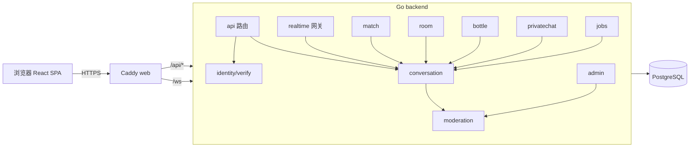

# 架构与模块概览

> 以代码为准，最后同步于 V1。

## 架构图

## 模块职责（`backend/internal`）

| 模块 | 职责 |
|---|---|
| `config` | 从环境变量加载并校验配置（含生产约束） |
| `platform/db` | pgxpool 连接池 |
| `platform/httpx` | JSON 响应与统一错误码、RequestID/日志/Recover/安全头、Origin 校验、ClientIP 解析 |
| `store` | sqlc 生成代码 |
| `identity` | 匿名身份签发/校验/重置；`__Host-anon` Cookie；昵称/头像种子；`RequireIdentity` |
| `verify` | 手机号验证码；`SMSProvider`(console)；AES-256-GCM + HMAC；`RequireVerified` |
| `realtime` | `GET /ws` 握手（Origin→身份→封禁→升级）；Hub/Broker/Presence 内存实现；协议编解码；Router；心跳/慢客户端/优雅关闭 |
| `conversation` | 会话/成员/消息仓储；发送管道；阅后即焚；历史分页；会话详情；屏蔽会话/成员 |
| `match` | 随机匹配队列、配对规则、断线宽限、`match.*` 处理 |
| `room` | 官方聊天室列表/历史、`room.join/leave`、在线人数合并推送 |
| `bottle` | 漂流瓶投放/捞取/扔回/回复/我的/举报 |
| `privatechat` | 私密链接创建/查询/加入/销毁，过期扫描 |
| `moderation` | 限流（固定窗口/令牌桶 + Limits 配置）、敏感词 AC、屏蔽、举报快照、`BanService`（含缓存放踢） |
| `admin` | 管理员会话、举报处理、封禁管理、统计、审计；`RequireAdmin`；IP 白名单 |
| `jobs` | 保留期清理（消息/会话/瓶子/链接/验证码/日志/举报/管理员会话/身份） |

## 消息发送管道（`msg.send`）

`realtime.Router` 分发 → `conversation.HandleSend`：
1. 校验载荷（conversationId、clientMsgId、kind=text、正文去空白后 1..1000 rune）；
2. 成员校验（未离开）→ 会话未结束；
3. 限流钩子（身份令牌桶；房间内另有 1 秒/房间间隔）；
4. 内容过滤钩子（敏感词 block/mask）；
5. 幂等落库 `INSERT ... ON CONFLICT (sender_identity_id, client_msg_id) DO NOTHING`；
6. 先回 `ack`，再 `Broker.Broadcast` 给会话订阅连接（排除屏蔽了发送者的身份）。

## 实时状态（V1 内存 / V2 可换 Redis）

`realtime.Realtime` 组合 `Presence` + `Broker` + `Subscriber` + `ConnStats` 接口，V1 由 `*Hub` 实现。
业务模块（room/match/bottle/privatechat）只依赖该接口，便于 V2 用 Redis 实现替换。
